# 工作量评估助手

> 需求文档 → IFPUG 功能点 → 成品造价表（引擎直连）

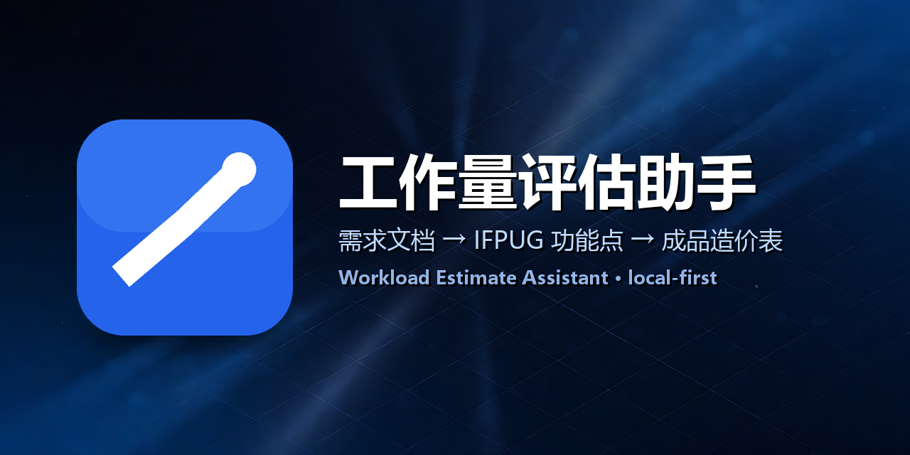

    

本地运行的软件项目工作量评估工具：上传需求说明书，自动识别 IFPUG 功能点并生成符合企业造价模板的成品评估表；同时提供 NESMA 快速估算与 PERT 三点估算，支持大模型（LLM）辅助识别与拆分。全部计算在本地完成，需求文档不出本机。

> 上文徽章是仓库内本地 SVG（`assets/badges/`，由 `python scripts/make_badges.py` 生成），不引用 shields.io 等外部图床 —— 离线 / 内网环境同样正常渲染。

## 特性

- **IFPUG 估算**：上传 `.docx` 需求文档 → 本地引擎解析候选功能点 → 逐条审核（类别/复杂度/重用/修改）→ 一键生成《规模估算》《费用估算》成品 xlsx（公式与样式保真，Excel 打开即重算）
- **NESMA 快速估算**：数 ILF/EIF 即出规模与费用，支持预估法 / 估算法两种口径，适合需求早期拿量级
- **PERT 三点估算**：新建/选择项目 → 需求导入（AI 拆分或人工录入）→ 乐观/最可能/悲观三值 → 预期 = (O + 4M + P) ÷ 6、σ = (P − O) ÷ 6 → 生成 PERT 成品表（成品表需自备母版：放 `tpl/pert-template.xlsx`，或用 `WE_TPL_PERT` 指向母版文件；两者都没有时会提示需自备，属预期行为）
- **大模型识别增强**：配置中心可接入任意 OpenAI 兼容接口（OpenAI / Claude / 通义 / 火山 / Agnes / 自定义），支持连接测试、模型列表自动拉取；启用后对候选做复核补全，并可注入项目上下文目录扫描出的技术栈/规模信息
- **估算历史与版本对比**：估算历史持久化、重开复用，两次估算可逐项 diff（新增/删除/变更高亮）
- **用户故事导出**：结果页按 INVEST 模板从已确认功能点生成用户故事（含验收标准与规模），导出 MD/CSV，可一键推送到 GitHub Issues（token/仓库自配，失败可重试）
- **母版管理**：配置中心可上传新成品母版并登记口径说明，生成时按所选母版出表
- **多语言与主题**：界面中/英双语切换（893 组文案 key 全量对齐）；浅色 / 深色 / 高对比三套主题，品牌主色可自定义
- **可访问性**：全链路键盘可完成主流程，语义化 role/aria，焦点环与对比度按 WCAG 口径校验
- **项目库与参数持久化**：PERT 项目、估算项、费率、母版模板、识别规则统一落库 SQLite，支持多项目管理与在线编辑
- **桌面应用**：Electron 壳 + PyInstaller sidecar，安装即用；前端图标库本地内联，离线/内网环境正常渲染；关窗前自动检测仍在运行的估算任务并二次确认
- **数据与运维**：配置中心可一键导出/导入全量数据（含 schema 版本），提供诊断包导出与更新源检查入口
- **命令行模式**：`scripts/we_cli.py` 无人值守出表，退出码可信（0 成功 / 2 输入非法 / 3 生成失败），可挂进调度脚本
- **本地目录选择**：配置中心浏览目录走系统原生对话框，返回绝对路径自动填入

## 产品介绍（图文）

软件项目要报价、要立项、要结算，绕不开一个问题：这份需求到底值多少人天？靠经验拍脑袋，口径每次都不一样；靠 Excel 手工拆功能点，一份中等规模的需求说明书要拆上一两天，还容易漏项、算错。

工作量评估助手把这段最费时、最容易出分歧的工作做成了流水线：**上传需求说明书（`.docx`）→ 引擎按 IFPUG 规则识别候选功能点 → 逐条人工复核（类别、复杂度、重用、修改类型）→ 一键生成与企业造价模板完全一致的成品评估表（`.xlsx`）**。成品表沿用母版公式与样式，Excel 打开即自动重算；评审会上拿出的还是那张熟悉的表，只是这次数据是算出来的，每一步都可追溯。

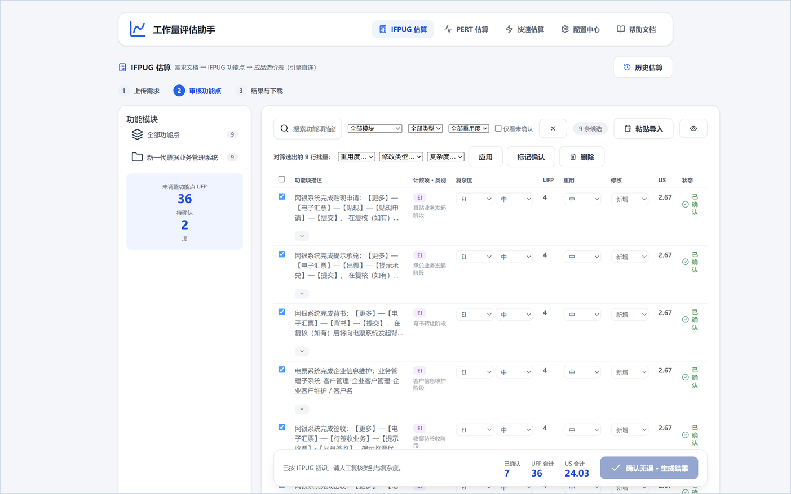

三步走完一次估算：

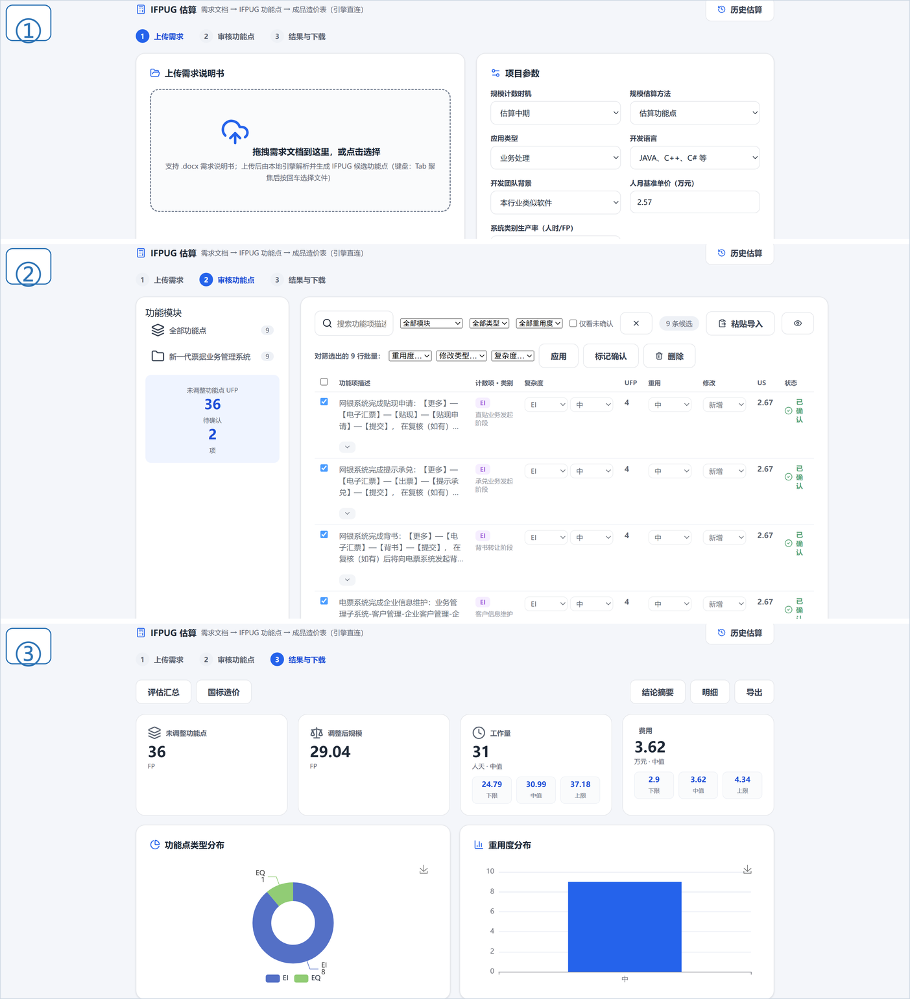

### IFPUG 功能点估算：从需求文档到造价表

拖入 `.docx` 需求说明书，引擎依次解析章节结构、定位功能需求清单表、按动作词与数据结构判定候选功能的 IFPUG 类型（ILF / EIF / EI / EO / EQ）并给出判定依据。复核页可逐条调整类别、复杂度、重用与修改类型，右侧实时汇总 UFP、US 与费用，改一条看一条。

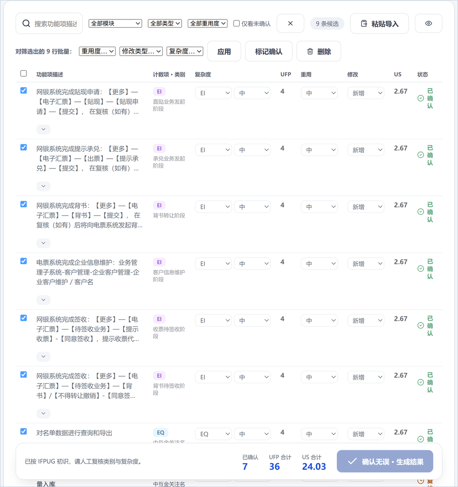

### NESMA 快速估算：十分钟拿到量级

需求还在讨论阶段、连功能点都拆不细时，只需数清 ILF 与 EIF，即可按预估法 / 估算法出规模与费用区间，并同步给出国标造价与 PERT 参考。

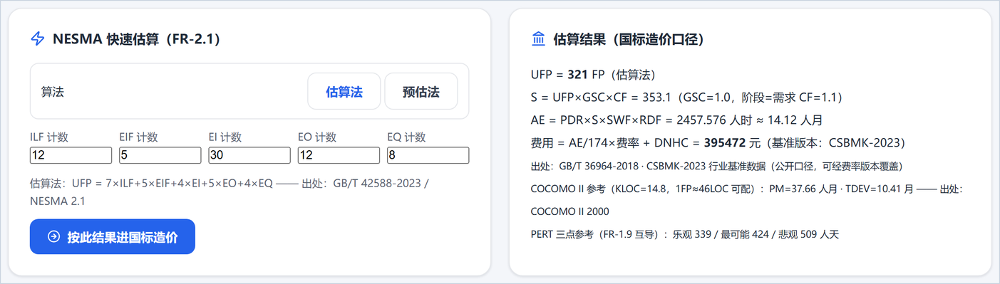

### PERT 三点估算：给工期一个区间而不是一个数

按项目录入估算项，填乐观 / 最可能 / 悲观三值，系统按 (O + 4M + P) ÷ 6 计算预期工期、按 (P − O) ÷ 6 计算标准差，折算理想人月与实际预估人月；项目长期保存，支持需求文档导入候选条目（人工录入或 AI 拆分）。

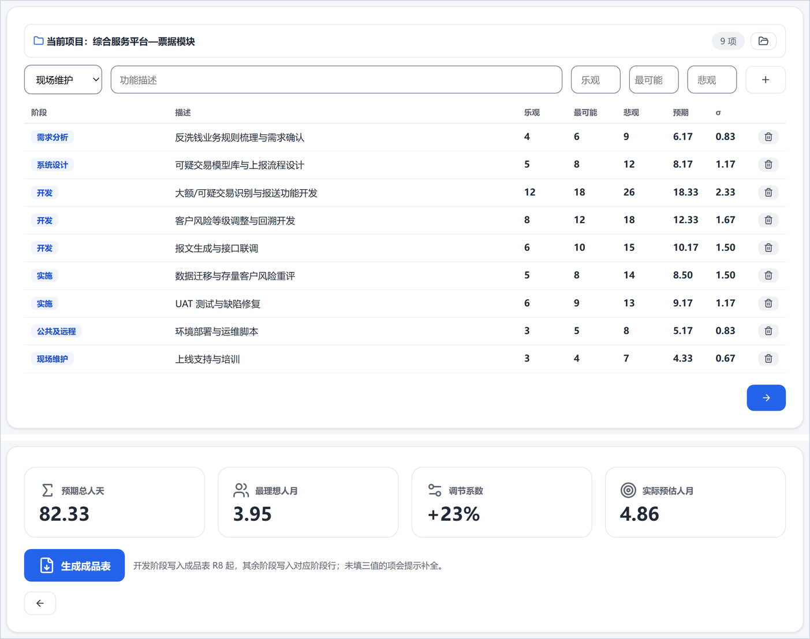

### 大模型识别增强：把「漏项」交给模型兜底

配置中心可接入任意 OpenAI 兼容接口，支持连接测试与模型列表自动拉取；启用后由模型对本地规则识别出的候选做复核补全，并可结合项目上下文目录扫描出的技术栈与规模信息。是否启用、用哪个模型，由使用者决定。

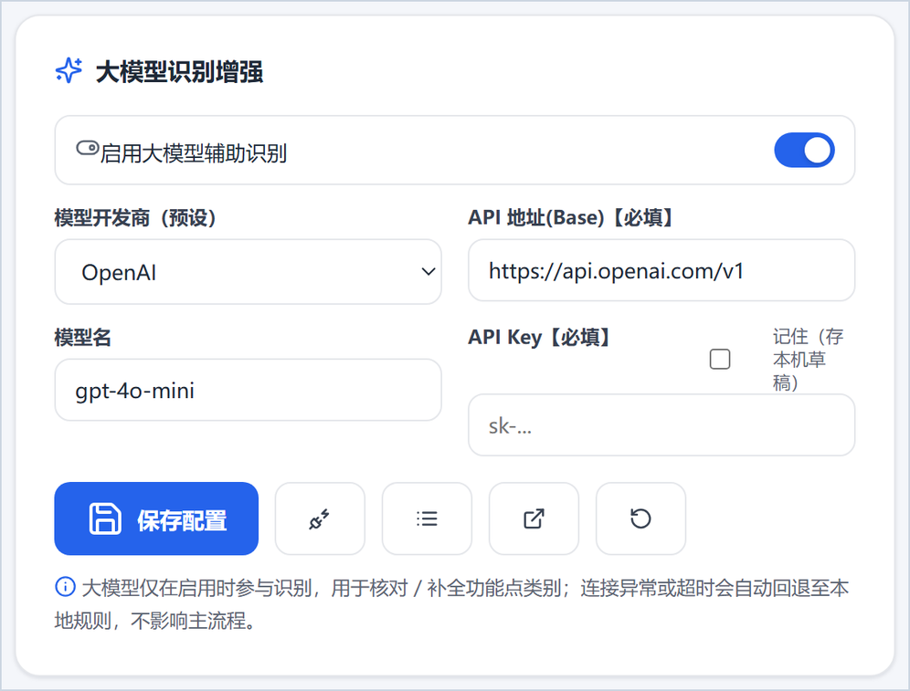

### 母版保真出表：Excel 打开即重算

成品表以母版为基座生成：明细写入数据区，公式、条件格式、合并单元格与列宽样式原样保留；母版可在配置中心随时替换并登记口径说明，换客户、换费率不需要改代码。

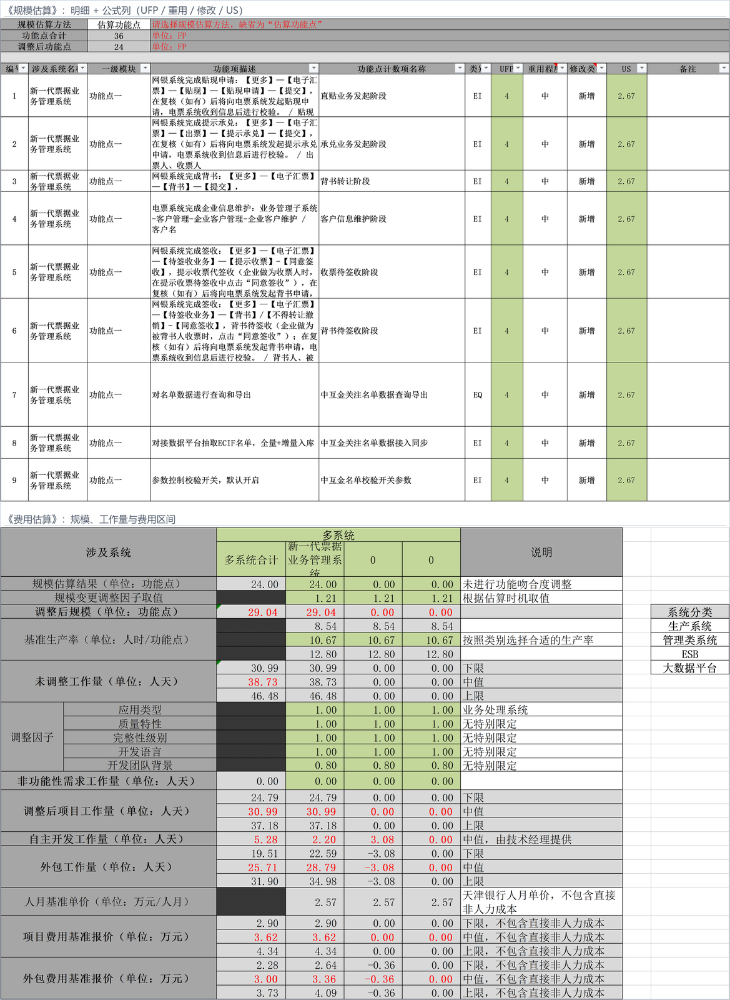

### 估算历史与版本对比

每次估算自动落库留痕，可重开继续调整；同一项目的两次估算支持逐项 diff，新增、删除、金额与工作量变化高亮显示。

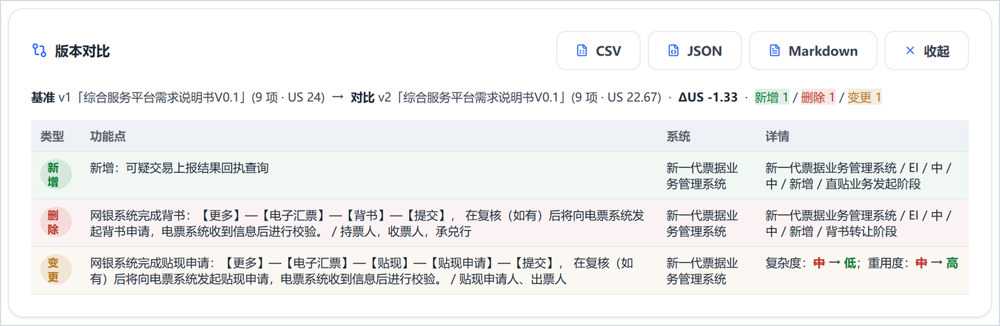


### 用户故事导出：从评估结果直达研发待办

结果页按 INVEST 模板把已确认的功能点生成为用户故事（含验收标准与规模），导出 MD / CSV，或一键推送到 GitHub Issues（仓库与 token 由使用者自配）。

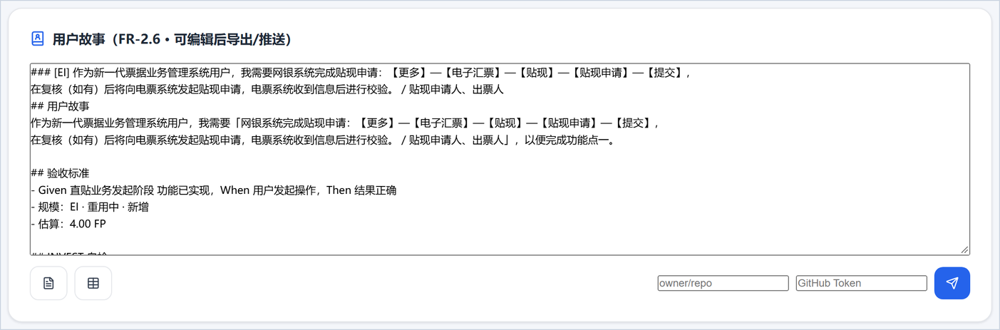

### 桌面应用与无人值守命令行

桌面版为 Electron 壳 + 本地引擎一体安装包，安装即用；关窗前自动检测仍在运行的估算任务并二次确认。批量或定时出表用命令行模式 `scripts/we_cli.py`，以退出码表达结果（0 成功 / 2 输入非法 / 3 生成失败）。

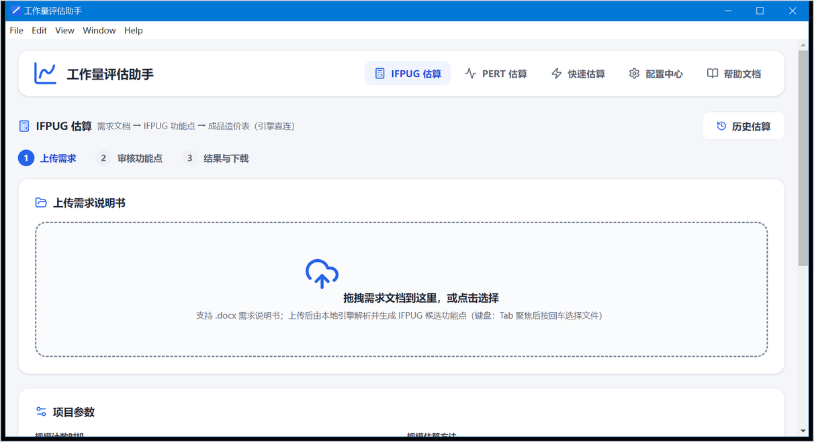

### 多语言、主题与可访问性

界面支持中 / 英双语切换，浅色、深色、高对比三套主题，品牌主色可自定义；全链路可用键盘完成主流程，语义化 role/aria 与对比度按 WCAG 口径校验。

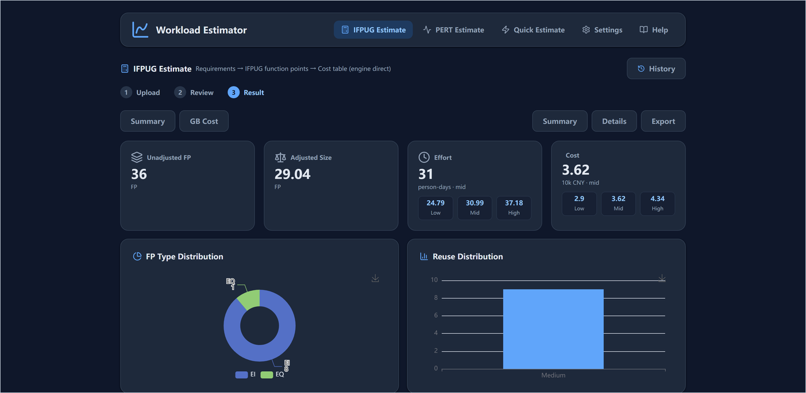

### 典型场景

- **立项与预算评审**：用 NESMA 十分钟出一版量级，评审通过后转 IFPUG 正式评估出造价表，前后口径同源、可解释。
- **外包采购与结算**：统一规则逐条拆解并留痕，两次评估的差异可逐项对比，结算依据从口头协商变为可复算的表格。
- **多项目并行**：PERT 给出的是区间而非单点，预期工期配合悲观值可直接用于排期缓冲与风险披露。
- **内网 / 隔离环境**：计算、存储与界面资源全部本地化，不依赖 CDN 与外网服务，需求文档不出本机（启用大模型增强时需自备可访问的模型服务）。

完整图文版（封面、应用场景全文与计算口径速查）见 [docs/工作量评估助手-产品介绍.docx](docs/工作量评估助手-产品介绍.docx)；该文档由 `python tools/docs/product-intro/build.py` 从仓库内图版重建。

## 技术栈

| 层 | 选型 |
|---|---|
| 本地引擎 | Python 3.10+ 标准库 `http.server`（无 Web 框架）+ `python-docx` 解析需求 + `openpyxl` 保真写母版 + SQLite 项目库/历史 |
| 前端 | 原生 JS 单文件页面，无框架、无 CDN：ECharts 与 lucide 图标库本地内联（`frontend/echarts.min.js`、`frontend/src/js/00_vendor_lucide.js`）；源码分模块，由 `scripts/build_frontend.py` 打包成 `frontend/index.html` |
| 桌面 | Electron 壳（`dev-shell/`）+ PyInstaller 单文件 sidecar（`工作量评估工具.spec`）+ electron-builder NSIS 安装包 |
| 测试 | Node 编排器 `tests/run.mjs` + 无头 Chrome（直连 CDP，非 Selenium/Playwright）+ Python 单测 |
| 发布 | `scripts/publish-release.py` 零依赖直连 GitHub REST API（标签 = `package.json` 的 `version`） |
| 文案 | `data/i18n/{zh-CN,en-US}.json` 字典 + 运行时 `/api/i18n` 下发；服务端提示走 msgKey + 过渡映射表 |

## 页面导览

| 页面 | 用途 |
|---|---|
| IFPUG 估算 | 上传需求 → 审核功能点 → 生成成品造价表 |
| 快速估算 | NESMA 预估/估算法，数 ILF/EIF 即出规模与费用 |
| PERT 估算 | 三点估算与项目库管理 |
| 配置中心 | 大模型识别增强、连接测试与模型管理、主题/母版/费率 |
| 帮助文档 | 评估方法论与计算算法说明、更新检查 |

## 计算口径（与母版 Excel 公式对齐）

| 项 | 口径 |
|---|---|
| UFP | 估算功能点法：ILF=10 / EIF=7 / EI=4 / EO=5 / EQ=4（预估功能点法 ILF=35 / EIF=15，事务类回退估算权重） |
| US | UFP × 重用系数（低 1 / 中 2/3 / 高 1/3） × 修改系数（新增 1 / 修改 0.8 / 删除 0.2） |
| 调整后规模 | US × 规模变更调整因子（估算早期 1.39 / 中期 1.21 / 晚期 1.10 / 交付后及运维 1.00） |
| 工作量 | 调整后规模 × 中值生产率 10.67 人时/FP ÷ 8 × 调整因子 0.8（低/中/高 ±20%） |
| 费用 | 工作量 ÷ 22 人/月 × 2.57 万元/人月 |

内置金标准校验：引擎复算母版 US 合计必须等于 `105.07`（`python scripts/generate_xlsx.py --verify`）。

## 安装

### 桌面版（推荐）

从 `release/` 获取安装包 `WorkloadEstimate-<版本>-setup.exe`（版本号为日期序列 `0.1.YYYYMMDD-NNN`，与 `package.json` 的 `version` 一致），双击安装后启动桌面应用（自动拉起本地引擎并打开界面）。已发布到 GitHub Releases 的版本同样以该标签命名。

### 开发运行

依赖：Python 3.10+（需 `python-docx`、`openpyxl`）

```bash
# 方式一：启动脚本（引擎 8020 端口 + 自动打开前端）
scripts\启动服务.bat

# 方式二：手动启动
python scripts/server.py 8020
# 浏览器访问 http://127.0.0.1:8020
```

## 快速开始

1. 打开 **IFPUG 估算** 页，拖入需求说明书（`.docx`）
2. 在 **审核功能点** 步骤确认/调整每条候选的类别、复杂度、重用与修改类型
3. 点击 **生成成品造价表**，下载成品 xlsx（含规模估算、费用估算与汇总）
4. 如需 AI 识别增强，先到 **配置中心** 填写 API 地址与 Key 并启用
5. 只需量级时切到 **快速估算**，填 ILF/EIF 数量直接出表

无人值守出表：

```bash
python scripts/we_cli.py --docx 需求说明书.docx --out 评估表.xlsx --method 估算功能点
```

## 构建

```bat
rem 一条命令跑完全流程（0 清空 release -> 1 停占用 -> 2 依赖校验 -> 3 金标准
rem -> 4 源码 zip -> 5 sidecar exe -> 6 桌面安装包）
scripts\构建打包.bat

rem 只清空发布目录（产物均可重建，可随时清理）
scripts\清理发布目录.bat

rem 保留现有产物、跳过清理再构建
set SKIP_CLEAN=1 && scripts\构建打包.bat
```

产物固定落在 `release/`：`workload-estimate.zip`、`exe\工作量评估工具.exe`、`WorkloadEstimate-<版本>-setup.exe`。
electron-builder 的中间产物（`win-unpacked\resources\app.asar`）输出到系统临时目录 `%TEMP%\we-eb-out`，
构建完成后只把 `setup.exe` 移回 `release` —— 避免 asar 落进工作区后被 IDE/索引进程独占打开，
导致 `release` 整个目录删不掉、改不了名。

前端源码在 `frontend/src/`（`index.src.html` + `js/*` + `css/*`），由 `python scripts/build_frontend.py`
打包成单文件 `frontend/index.html`；改完 `src` 必须重新构建，否则运行的仍是旧产物（`index.html` 入库，构建后一并提交）。

产品介绍 Word（`docs/工作量评估助手-产品介绍.docx`）由仓库内图版重建：
`python tools/docs/product-intro/build.py`。图版在 `docs/assets/product-intro/`，重采界面底图 /
重拼图版 / 逐页目检的参数见 [tools/docs/product-intro/README.md](tools/docs/product-intro/README.md)。

> 清理失败时的排查：脚本会自动列出删不掉的文件与占用进程
> （`python scripts\_rm_locks.py release`）。历史遗留的 `release\*\win-unpacked\resources\app.asar`
> 若被 WorkBuddy.exe 索引句柄占住（err=32），需要**重启 WorkBuddy 后**再跑一次清理脚本。

## 发布（一键发布到 GitHub Releases）

`scripts\一键发布.bat` 在「构建」基础上多了「发布」一步：调用 `构建打包.bat` 出包 →
定位 `release\WorkloadEstimate-<版本>-setup.exe` → 生成/复用发布说明 →
`scripts\publish-release.py` 创建（或复用）GitHub Release 并上传安装包。

```bat
rem 一键构建并发布（需先在 .env 配置 GH_TOKEN，详见 scripts\.env.example）
scripts\一键发布.bat

rem 只打印将要执行的发布动作、不真正发布
set GH_DRY_RUN=1 && scripts\一键发布.bat
```

- 配置全部走 `scripts\publish.config.json`（仓库坐标、镜像源、构建入口、版本/安装包 glob 等），不硬编码。
- Token 仅从本地 `.env`（`GH_TOKEN=...`，已被 `.gitignore` 忽略）或 git 凭据库读取，绝不入库。
- 版本号取 `package.json` 的 `version`（形如 `0.1.YYYYMMDD-NNN`）作为 Release 标签。
- 发布说明优先用 `release-notes-<版本>.md`，缺失时自动用 `git log` 生成。
- 编码规范：`.bat` 纯 ASCII + `chcp 65001`，`.ps1` 全部 UTF-8 BOM；`scripts\verify.ps1` 可做字节级静态校验。

## 目录结构

```
├── frontend/
│   ├── src/                   # 前端源码（index.src.html + js/ 12 模块 + css/）
│   └── index.html             # 构建产物：单文件前端（含本地内联图标库，无 CDN 依赖）
├── scripts/
│   ├── server.py              # 本地引擎：stdlib http.server，REST API + 前端托管
│   ├── engine.py              # IFPUG 规则引擎（US/汇总口径）
│   ├── gb_engine.py           # 国标费率与基准（多版本存取）
│   ├── generate_xlsx.py       # 母版保真生成器（写明细、保公式、Excel 重算）
│   ├── pert.py                # PERT 库与成品表生成
│   ├── history.py             # 估算历史与版本 diff
│   ├── replay_recognize.py    # 功能点类型/修改类型识别规则
│   ├── we_cli.py              # 命令行 / 无人值守模式
│   ├── build_frontend.py      # 前端源码 → 单文件 index.html
│   ├── publish-release.py     # GitHub Release 发布器（零依赖 REST）
│   └── make_badges.py         # README 本地徽章生成（离线可用，替代外链图床）
├── data/
│   ├── i18n/                  # 界面文案字典 zh-CN.json / en-US.json（893 key 对齐，入库）
│   ├── testdocs/              # 回归夹具 t00928_req.docx（S3~S9 依赖，入库）
│   ├── config.json            # 运行配置（LLM 预设、上下文目录、主题）——本地产物，已忽略
│   └── pert.db / estimation.db# 项目库与估算历史——本地产物，已忽略
├── tpl/template.xlsx          # 成品母版（公式/样式保真基座）
├── tpl/pert-template.xlsx     # PERT 成品母版（可选，需自备；也可用 WE_TPL_PERT 指定，缺省则提示需自备）
├── 工作量评估工具.spec         # 手写 PyInstaller 构建定义（datas/hiddenimports/图标），sidecar exe 依赖它
├── tests/                     # 回归套件（S1–S12：Python 单测 + API 冒烟 + UI 冒烟）
├── tools/docs/product-intro/  # 产品介绍文档生成链（图版拼装 + docx 生成 + 可选界面采集）
├── docs/                      # 设计与方法论文档（见下方「设计文档」）
├── dev-shell/                 # Electron 壳（main.js 拉起 sidecar 并托管窗口）
├── assets/                    # 应用图标、README 徽章与社交预览图
├── scripts\构建打包.bat        # 一键构建（先清 release，再 zip / exe / 安装包）
├── scripts\清理发布目录.bat    # 清空 release（可随时执行，产物可重建）
├── scripts\一键发布.bat        # 一键发布（构建 + 发布到 GitHub Releases，纯 ASCII 入口）
├── scripts\publish.ps1         # 发布主逻辑（UTF-8 BOM，配置驱动）
├── scripts\publish.config.json # 发布配置（零硬编码）
├── scripts\publish-release.py  # 通用 GitHub Release 发布器（零依赖）
├── scripts\verify.ps1          # 脚本编码/语法静态校验
└── release/                   # 构建产物（zip、sidecar exe、安装包），可随时清理
```

## 测试

```bash
npm test                  # 全量 12 套件
npm test -- --only=S3,S4  # 只跑指定套件
```

编排器（`tests/run.mjs`）跑 S1–S12 共 12 个套件，默认全部纳入（S6 的偶发卡死已在 T01079 根因修复，夹具改绝对路径后转为 default-on）：

| 套件 | 内容 |
|---|---|
| S1 / S2 / S10 | Python 单测：识别规则表驱动对拍、引擎口径、CLI 无人值守 |
| S3 | API 冒烟（隔离实例全链路） |
| S4 / S5 / S7 / S8 / S9 / S11 / S12 | UI 冒烟（无头 Chrome + CDP）：上传→识别→审核→生成→导出、表格增强与规则沉淀、版本 diff、主题定制、键盘可达、动效空态、界面多语言 |
| S6 | UI 进度/失败/超时 |

辅助校验：`python tests/i18n_check.py`（双语 key 对齐、服务端 msgKey 覆盖）、`python tests/refactor_guard.py <基线.json> [--save]`（重构前后对本地引擎 8092 端口的 API 响应做归一化快照逐字节对拍，需先起服务）、`python scripts/generate_xlsx.py --verify`（金标准）。**12/12 全绿为交付线。**

## 主要接口

引擎是 stdlib `http.server`，无框架依赖；前端与桌面壳共用同一套接口。

| 方法 | 路径 | 说明 |
|---|---|---|
| GET | `/api/health` | 引擎就绪探针（含金标准口径回显） |
| POST | `/api/recognize` | 上传需求 docx(base64) → 候选功能点清单 |
| POST | `/api/generate` | 候选清单 + 参数 → 成品 xlsx（返回下载句柄） |
| GET | `/api/generate/progress` | 生成分阶段进度轮询 |
| GET | `/api/jobs/running` | 仍在运行的估算任务（桌面端关窗前确认） |
| GET | `/api/download?s=` | 下载生成的成品表 |
| GET/POST | `/api/config` | 配置中心读写；`/api/config/test` 连接测试、`/api/config/models` 拉取模型列表 |
| GET | `/api/i18n` | 按语言取界面文案字典（运行时下发，语言白名单 + 路径穿越防护） |
| GET/POST | `/api/context` | 项目上下文目录扫描结果与技术栈分析 |
| GET/POST | `/api/history` | 估算历史持久化与重开复用；`/api/history/diff` 两次估算逐项对比 |
| GET/POST | `/api/rules` | 功能点识别规则读写 |
| GET/POST | `/api/rates` | 费率与基准（国标口径）多版本读写 |
| GET/POST | `/api/templates` | 成品母版模板目录与口径说明 |
| POST | `/api/pert/*` | PERT 项目/估算项/导入/生成（`project`、`item`、`import`、`import/confirm`、`generate`、`list`、`delete`） |
| POST | `/api/pickdir` | 系统原生目录选择，返回绝对路径 |
| POST | `/api/story/push` | 用户故事推送到 GitHub Issues（`token`/`repo`/`stories`，单次上限 50 条，失败逐条回传可重试） |
| POST | `/api/data/export` `/api/data/import` | 全量数据导出/导入（zip，含 schema 版本） |
| GET | `/api/diag` | 诊断包导出（日志 + 数据快照） |
| GET/POST | `/api/update/*` | 更新源检查、下载与安装进度 |

## 设计文档

- `docs/概要设计说明.md` — 总体架构、模块划分、数据模型、计算口径（含 NESMA 与国标造价）
- `docs/设计-结果页与导出.md` — 结果页四图、导出管线、信息架构与可访问性
- `docs/设计-前端架构与交互.md` — 前端拆分与构建、复核表格、规则沉淀、设计令牌与主题、生态扩展
- `docs/设计-数据与运维.md` — 估算历史与版本、入参校验、日志诊断、备份迁移、S1–S12 测试体系
- `docs/设计-多语言边界-交付物恒为中文.md` — 界面双语与交付物语言边界

## 常见问题

- **S3~S12 集体报「API 实例未就绪」**：默认 `python` 缺 `openpyxl` 会连片假失败，改用带依赖的解释器：`PYTHON="/f/Program Files/Python3.14/python" npm test`。
- **`release/` 删不掉、改不了名**：历史遗留的 `release\*\win-unpacked\resources\app.asar` 可能被索引进程句柄占住（err=32）。`python scripts\_rm_locks.py release` 会列出占用者，重启 WorkBuddy 后再跑一次清理脚本。
- **内网/离线构建拉不到 electron**：镜像源集中在 `scripts/publish.config.json` 的 `env` 段（`ELECTRON_MIRROR` / `ELECTRON_BUILDER_BINARIES_MIRROR`），不在脚本里硬编码；前端本身无 CDN 依赖。
- **界面切成英文后导出的表还是中文**：这是设计边界，交付物（成品 xlsx / PERT 表 / 用户故事）恒为中文，理由与影响面见 `docs/设计-多语言边界-交付物恒为中文.md`。
- **整跑时 S4/S6 偶发 FAIL、单跑却全绿**：无头 Chrome + CDP 在连续跑 UI 套件时会资源竞争（2026-10-29 实测：整跑 10/12 → `--only=S4` 13/13、`--only=S6` 17/17 → 再整跑 12/12）。先复跑确认，**连续两次同项失败才按回归处理**。
- **双击 `scripts\一键发布.bat` 说没有 GH_TOKEN**：`.env` 要放在**仓库根**（脚本会先切到仓库根再加载），字段格式见 `scripts/.env.example`。

## 贡献指南

1. 拉取 `main`（本仓库单人维护，改动直接提交 `main`，提交信息以任务号开头，如 `T03631 README 同步…`，便于与任务系统互相溯源）。
2. 按改动类型自测：
   - 改前端：先 `python scripts/build_frontend.py` 重新打包 `frontend/index.html`，再 `npm test`；
   - 改计算口径：必须过金标准 `python scripts/generate_xlsx.py --verify`（US 合计 = `105.07`）；
   - 加界面文案：`data/i18n/zh-CN.json` 与 `en-US.json` **同时**补 key，跑 `python tests/i18n_check.py`（key 对齐 + 服务端 msgKey 覆盖）；
   - 加服务端提示：用 `scripts/server.py` 的 `_m(key, 中文兜底)` 返回 msgKey，前端经 `lm()` 查字典渲染，不要直接硬编码中文给英文态。
3. 交付线：`npm test` **12/12 全绿**；只跑单套件用 `npm test -- --only=S4`。
4. 不要提交：`data/` 运行时产物（`config.json`、`*.db`、`generated/`、`uploads/`）、`release/`、`logs/`、根目录 `.env`（`.gitignore` 已覆盖；`data/i18n/` 与 `data/testdocs/` 是例外，属源码/夹具必须入库）。
5. 发布：本地 `scripts\构建打包.bat` 出包，或 `scripts\一键发布.bat` 构建 + 发布 GitHub Releases（先 `set GH_DRY_RUN=1` 演练一遍）。

## 许可证

内部工具，未随附开源许可证。
