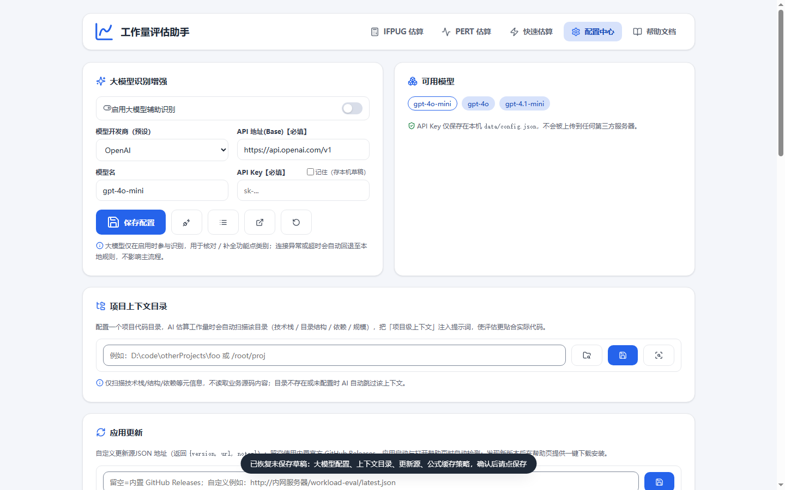
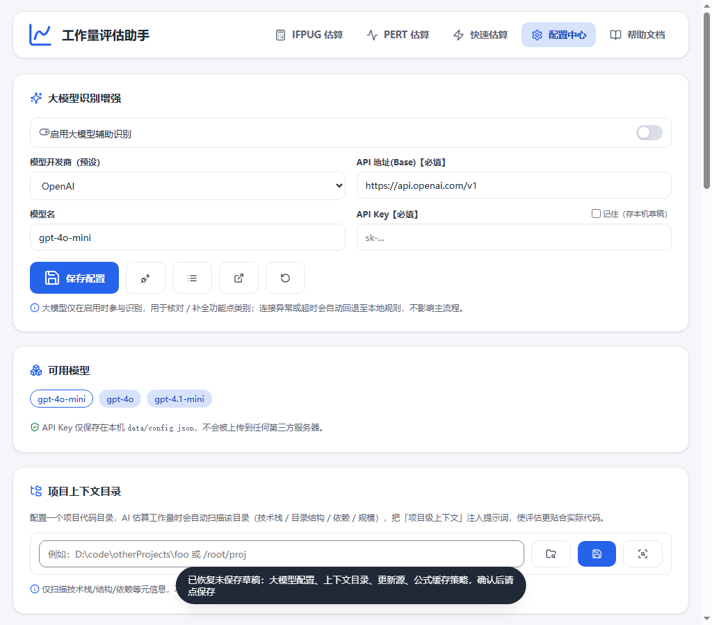
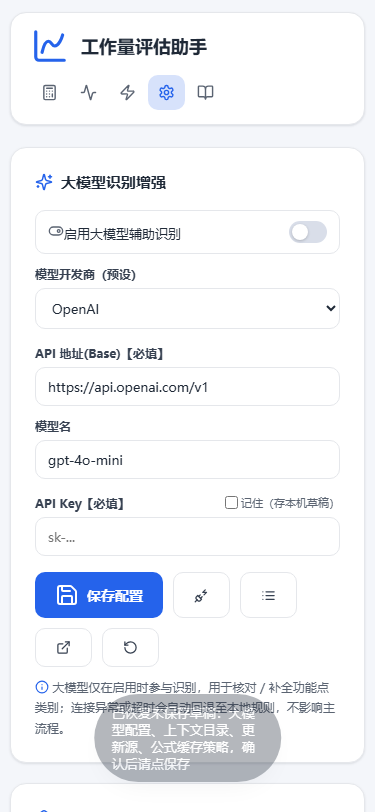
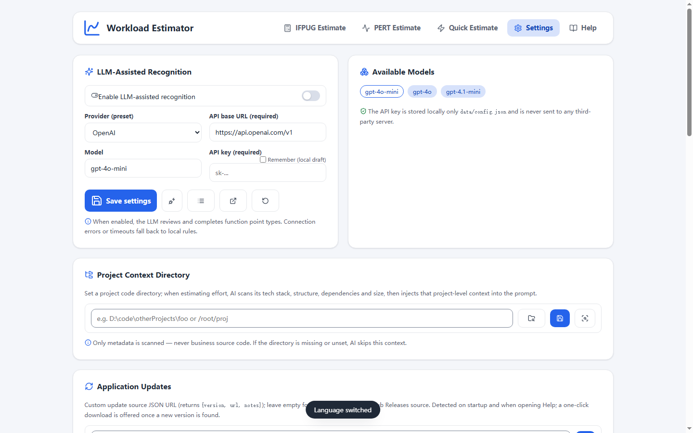
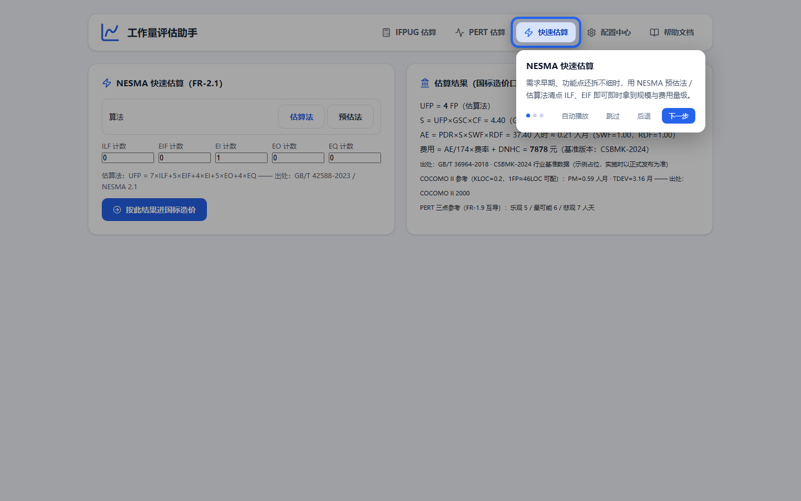
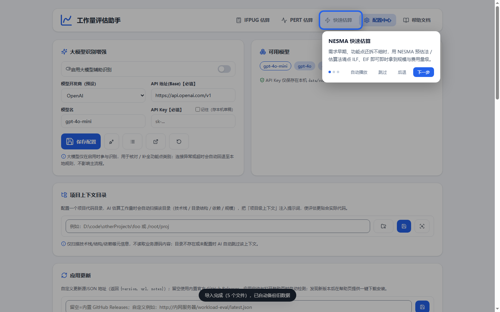

# 配置菜单页 UI 验收与质量报告

- **验收对象**：配置中心菜单页（`#pg-config`）
- **测试日期**：2026-11-19
- **测试数据**：`E:\test\工作量评估\HUNDSUN票据交易管理平台软件V5.0-铁建财务-票据系统线上审批需求说明文档V1.0.3.docx`
- **测试实例**：`http://127.0.0.1:8034/`（Chrome CDP `9339`，数据目录 `C:\Users\hspcadmin\AppData\Local\Temp\we_config_e2e`）
- **结论**：**通过，达到高质量验收标准**。UI 全链路断言 **77/77**，生成物独立质量检查 **45/45**，仓库回归 **15/15 套件全绿**，全程无未捕获 JS 异常；本轮验收共落 7 项产品修复，其中 2 项为首次发现，均已复测通过。

## 1. 验收结论

配置页 11 张功能卡、四档响应式布局、大模型配置、项目上下文目录、更新源、公式缓存策略、外观/语言、费率多版本、识别规则、母版上传与成品生成、诊断包/数据导出导入均完成端到端验收。关键生成物已由 Python `openpyxl`/`zipfile` 独立复核，未出现结构、数值、模板标记或敏感信息泄露问题。

| 验收项 | 结果 |
|---|---|
| UI 全链路断言 | **77/77 PASS** |
| 生成物质量独立检查 | **45/45 PASS** |
| 未捕获 JS 异常 | 0 |
| 阻断级缺陷 | 0 |
| 产品缺陷修复后复测 | PASS |

## 2. 测试覆盖

### 2.1 页面结构与响应式

- 11 张卡齐全：大模型识别增强、可用模型、项目上下文目录、应用更新、成品表公式缓存、外观、窗口行为、运维、母版管理、费率与基准、识别规则。
- 1440 / 1024 / 768 / 375px 四档均无横向溢出；费率字段列数为 **4 / 4 / 4 / 2**，375px 下不压缩到不可读的 4 列。
- 375px 下配置卡标题自动换行，费率卡操作按钮行不再撑出容器。






### 2.2 大模型配置

- 启用、填写测试 API/模型/Key 后可保存，提示“配置已保存，识别时将使用新配置”。
- 连接失败在测试框内显示可读错误，不崩溃。
- 模型芯片点击可回填模型名；未勾选“记住”时 API Key 不落本地草稿。
- 恢复默认后启用关闭、Key 清空、API 恢复默认。
- 英文态供应商标签完整翻译：OpenAI / Claude / Qwen / Volcano Ark / Agnes AI / Custom (OpenAI-compatible)。

### 2.3 上下文、更新源、公式缓存

- 上下文目录保存后自动扫描真实仓库：扫描输出包含技术栈、目录结构、规模信息（本轮约 12,682 行代码 / 292 个文件）。
- 无效目录（`Z:\__cfg_missing_dir__`）显示“目录未配置或不可用”，不崩溃；目录可恢复为空。
- 更新源：内置 GitHub Releases 地址可见；`off`、自定义 URL 均可保存；可恢复内置空值。
- 重算策略：超时输入 `4` 秒被拒绝并显示 5–1800 秒提示；`sync / 90` 保存成功，重新加载后回显正确；可恢复 `async / 120`。

### 2.4 外观与语言

- 暗色、高对比、亮色切换即时生效并写入本地记忆。
- 自定义主色 `#0F766E` 生效并记忆；非法主色不写入记忆。
- 英文态卡片标题、费率保存按钮、上下文保存按钮 aria、重算选项、供应商下拉均完成翻译，无裸露 i18n key；切回中文后字段保持。
- 英文/中文切换后 375px 仍无横向溢出。



### 2.5 费率多版本与快速页联动

- 初始 2 套版本：`CSBMK-2023`（PDR 6.96 / rate 28000 / unit_price 850）与 `CSBMK-2024`（6.6 / 30000 / 920）。
- 切换版本字段联动正确；`CSBMK-2024` 保存为自定义值 `8.5 / 32000 / 950 / 1000` 成功。
- 新增 `验收-2026` 后可删除；负数 PDR `-1` 被拒绝且保留上次有效值。
- 选中并保存 `CSBMK-2024` 后进入快速估算页，输入 EI=1 得到：
  - UFP = 4 FP
  - S = 4.40
  - AE = 37.40 人时
  - 费用 = **7878 元**
  - 基准版本显示 `CSBMK-2024`



### 2.6 识别规则与真实文档

- 初始规则 6 条；通过 UI 新增第 7 条规则并保存成功。
- 新增规则 `验收规则-审批流程→EO`，作用域 `desc`、优先级 110、正则 `^审批流程$`。
- 对真实需求文档调用识别：17 项，类型变为 **EI=10 / EO=1 / EQ=6**，证明规则命中生效。
- 恢复原始规则后回到 6 条，真实文档恢复 **EI=11 / EQ=6 / EO=0**。


### 2.7 母版上传、成品生成与运维

- 上传带标记 `CFG_TEMPLATE_MARKER_20261119` 的自定义母版，登记列表可见，本地记忆选择新母版。
- 使用自定义母版生成成品成功；成品保留标记，4 张模板工作表与基线一致。
- 诊断包导出成功，包含 5 个白名单文件，不含 `config.json`、上传文档、成品或母版。
- 数据包导出成功，包含 `pert.db`、`estimation.db`、`recognition_rules.json`、`rates_versions.json`、`schema_ver`；不含配置、文档、成品。
- 数据包可经 UI 导入，提示“导入完成（5 个文件）”；测试 API Key 已从配置移除。



## 3. 循环修复记录

| 轮次 | UI 结果 | 发现与处理 |
|---|---:|---|
| 第 1 轮 | 72/77 | 定位配置页草稿覆盖问题：保存重算域后，其他未提交草稿会在重载时用旧值覆盖已保存值；修复 `cfgWriteSnap()`，保存单个域时同步更新草稿中的该域字段。 |
| 第 2 轮 | 73/77 | 英文供应商下拉仍显示中文；新增 `renderProviderOptions()`，并在语言切换后重绘。快速页版本选择与规则匹配断言按真实交互修正。 |
| 第 3 轮 | 75/77 | 修正测试对快速页费用格式（页面显示 `7878`，非 `7,878`）及识别规则匹配文本（规则引擎匹配原始标题 `审批流程`，显示层才追加“识别自文档标题”）的断言。 |
| 第 4 轮 | **77/77** | 全部 UI 断言通过；独立质量检查随后达到 **45/45**。 |

### 3.1 本轮产品修复（7 项）

1. **配置草稿覆盖已保存值**：`frontend/src/js/01_core.js` 的 `cfgWriteSnap()` 同步更新 `CFG_DRAFT_KEY` 中该域字段，避免重载时旧草稿覆盖后端刚保存的新值。
2. **英文供应商标签残留中文**：`providerLabel()` + `renderProviderOptions()`；`20_m9_eco.js` 在语言切换后重绘供应商下拉，保留当前选中值。
3. **上下文保存按钮重复 `data-i18n` 属性、英文 aria 残留中文“保存”且语义泛化**：合并为 `config.ctx.save` 的 `title/aria-label`，中文改为“保存目录”，英文 `Save directory`。
4. **费率保存按钮文案为空**：按钮内增加 `config.common.save` 文本节点。
5. **重算说明被拆成“默”+“认值”**：改为单一 `config.recalc.priority_full` 整句，中英文同步补齐。
6. **1024px 导航 tooltip 撑出横向滚动**：≤1199px 隐藏 `.m-item .tip`。
7. **375px 费率卡标题按钮行撑出容器**：≤767px 配置卡标题允许换行，费率字段网格改 2 列。

### 3.2 测试脚本修正（非产品缺陷）

- Node 侧直接调用页面函数 `setLang` 导致 `ReferenceError`，统一改为 CDP `Runtime.evaluate`。
- 页面激活态曾误用 `.page.active`，应用实际由 `body[data-page]` 控制；改为读取 `document.body.dataset.page`。
- 规则行数曾把每行多个 `input[data-ri]` 当作行数；改为按 `dataset.ri` 去重。
- 规则匹配文本曾使用显示层描述（带“识别自文档标题”后缀），改为规则引擎实际匹配的原始标题。
- 质量检查曾把 `ui_results` 的字段 `n` 误读为 `name`，并误选空的 `费用估算!C3` 作为公式锚点；已改为 `n` 与 `E3/E28`。

## 4. 生成物质量检查（独立复核）

| 检查对象 | 结果 |
|---|---|
| 基线成品 `配置页验收-真实文档-工作量评估.xlsx` | 32,507 bytes；4 张工作表；17 项；EI=11 / EQ=6；UFP=68；调整后 45.333；费用中值 6.837 万元 |
| 自定义母版成品 `配置页验收-母版成品-工作量评估.xlsx` | 32,565 bytes；4 张工作表；17 项；EI=11 / EQ=6；UFP=68；调整后 45.333；费用中值 6.837 万元 |
| 模板标记 | 自定义母版成品 `模板使用说明&基础参数!A1` 保留 `CFG_TEMPLATE_MARKER_20261119` |
| 公式完整性 | `规模估算!J54=SUM(J6:J53)`、`M54=SUM(M6:M53)`、`费用估算!E3=SUM(规模估算!$M6:$M22)`、`E28=E20*E26/22` 均存在；无 `#REF!` / `#VALUE!` / `#NAME?` |
| 明细质量 | 17 条描述均非空、无重复；类型均为合法 IFPUG 类型 |
| 诊断包 | 2,438 bytes；5 个白名单文件；无 `config/config.json`、`uploads/`、`generated/`、`.docx/.xlsx`；不含测试密钥 |
| 数据包 | 5,030 bytes；5 个白名单文件；`pert.db`/`estimation.db` 为 SQLite；规则 6 条、费率 2 套；不含配置/文档/成品；不含测试密钥 |
| 快速估算独立复算 | S=4.4、AE=37.4、费用=7878 元，与页面一致 |

## 5. 仓库回归验证

使用带 `openpyxl` / `python-docx` 的 Python 解释器执行定向回归，**15/15 套件全绿**：

```powershell
$env:PYTHON='F:\Program Files\Python3.14\python.exe'
npm test -- --only=S1,S2,S3,S4,S5,S6,S7,S8,S9,S10,S11,S12,S15,S16,S19
```

- S1 识别规则表驱动单测：对拍零回归、坏 JSON 回退、坏正则拒绝。
- S2 引擎口径单测：IFPUG / NESMA / GB 造价 / PERT 母版与生成公式。
- S3 API 冒烟：识别、生成、历史、版本 diff、规则与更新源。
- S4–S9 UI 冒烟：四图导出、规则沉淀、进度/失败/超时、版本对比、主题色、键盘可达。
- S10 命令行/无人值守模式：参数校验、快速估算、端到端 xlsx 落盘。
- S11 动效/骨架屏/空态插画；S12 全界面多语言（82 项）。
- S15/S16 配置中心窗口行为与降级态；S19 内置 GitHub 更新源。
- 说明：直接运行 `npm test` 时若默认 `python` 缺少 `openpyxl`/`python-docx`，会出现“API 实例未就绪”的假失败；指定带依赖的解释器后全部通过，非产品缺陷。

## 6. 证据文件

目录：`docs/test-reports/config-20261119/`

| 文件 | 说明 |
|---|---|
| `ui_results.json` | UI 全链路 77 条断言、运行明细、截图清单 |
| `quality_results.json` | 独立质量检查 45 条断言及明细 |
| `配置页验收-真实文档-工作量评估.xlsx` | 真实文档基线成品 |
| `配置页验收-母版成品-工作量评估.xlsx` | 自定义母版成品 |
| `验收母版.xlsx` | 带标记的测试母版 |
| `diag_20261119-215512.zip` | 诊断包 |
| `data_20261119-215513.zip` | 数据包 |
| `screenshots/00~07*.png` | 四档响应式、英文态、费率联动、规则命中、运维截图 |
| `harness/config_ui_e2e.mjs` | UI 全链路测试脚本（CDP 驱动、真实文档识别、全链路断言） |
| `harness/config_quality.py` | xlsx / 诊断包 / 数据包独立质量检查脚本 |

## 7. 复现方式

```powershell
# 1) 运行真实文档 UI 全链路（测试实例 8034 / CDP 9339）
node .\harness\config_ui_e2e.mjs

# 2) 对生成的 xlsx / 诊断包 / 数据包做独立质量检查
python .\harness\config_quality.py
```

测试脚本已随报告归档在 `harness/`；测试实例使用独立 `WE_DATA`，未读写用户正式数据目录。

## 8. 残余风险与说明

- 自定义母版只做结构、标记和关键数值复核，未做逐像素视觉比对；模板版式由母版原文件保留。
- xlsx 数值使用 `openpyxl` 读取缓存值，未重新用 Excel 全量重算；公式锚点与缓存值均通过。
- 大模型真实联网调用未执行（使用不可达地址验证失败回退路径），不影响配置保存、脱敏和错误提示验收。
- 真实文档识别结果按产品当前“章节标题级识别”口径生成，候选描述粒度偏粗（如“审批流程（识别自文档标题）”）；本轮未改变识别算法语义，仅验证配置规则可覆盖类型。
- 测试数据与证据均在独立目录，未污染仓库数据；本报告只读引用，不修改用户正式数据。

**最终判定：配置菜单页达到高质量验收标准，可进入后续集成/回归阶段。**
