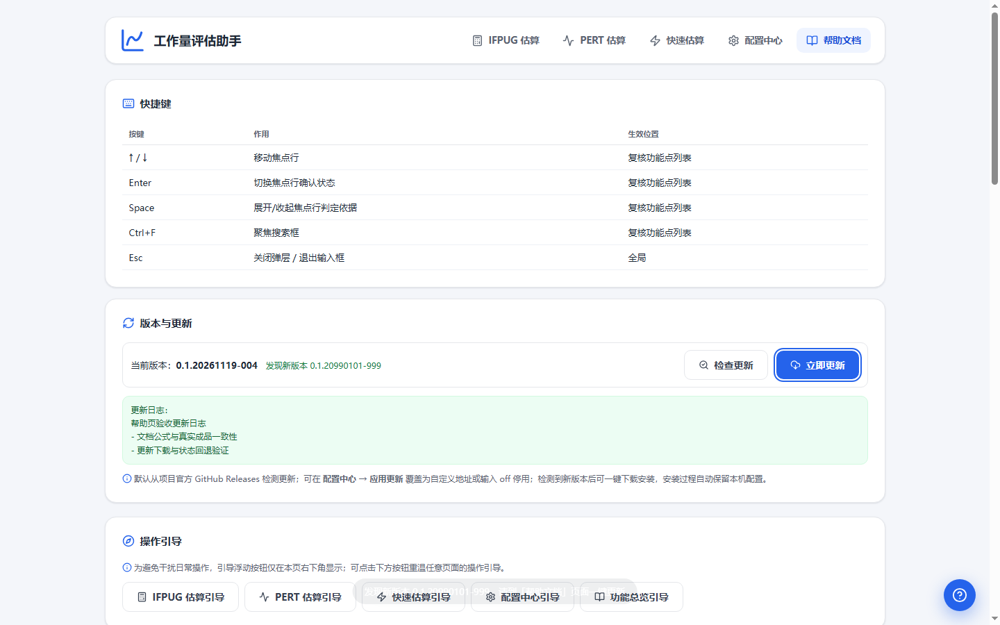
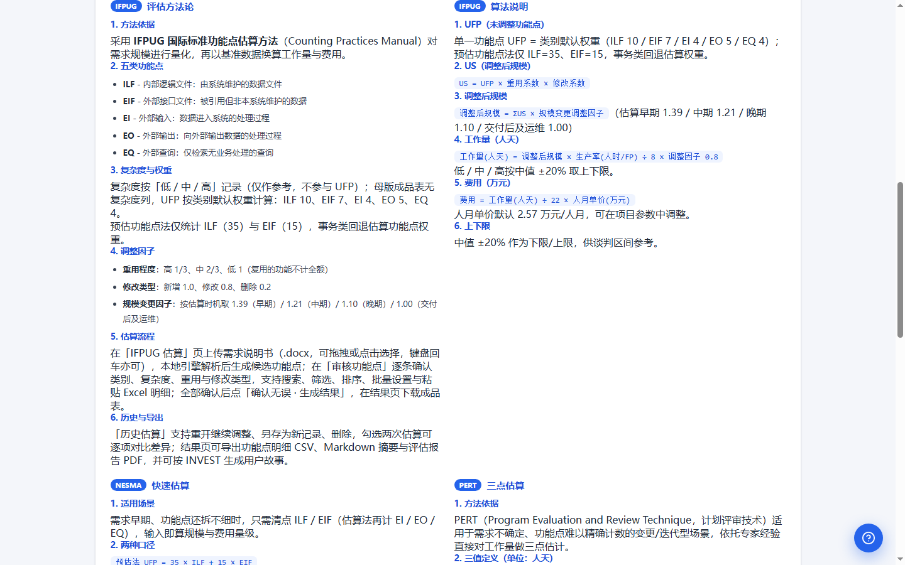
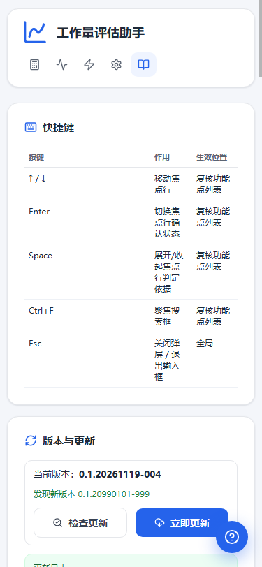
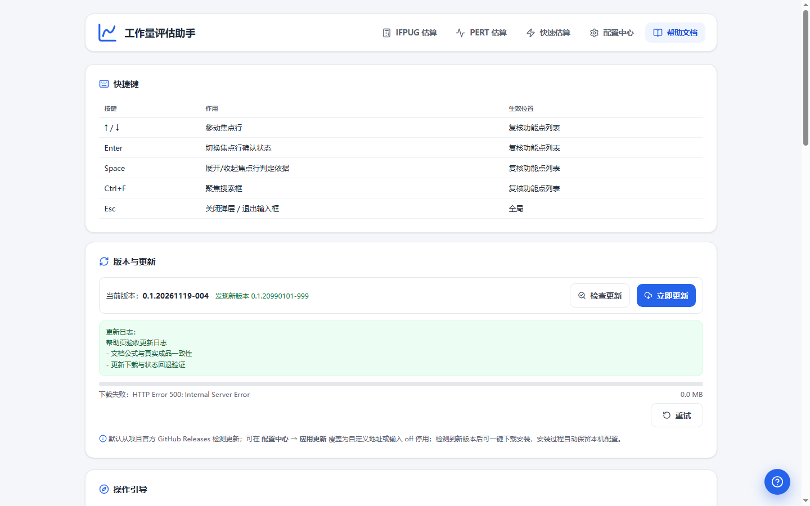
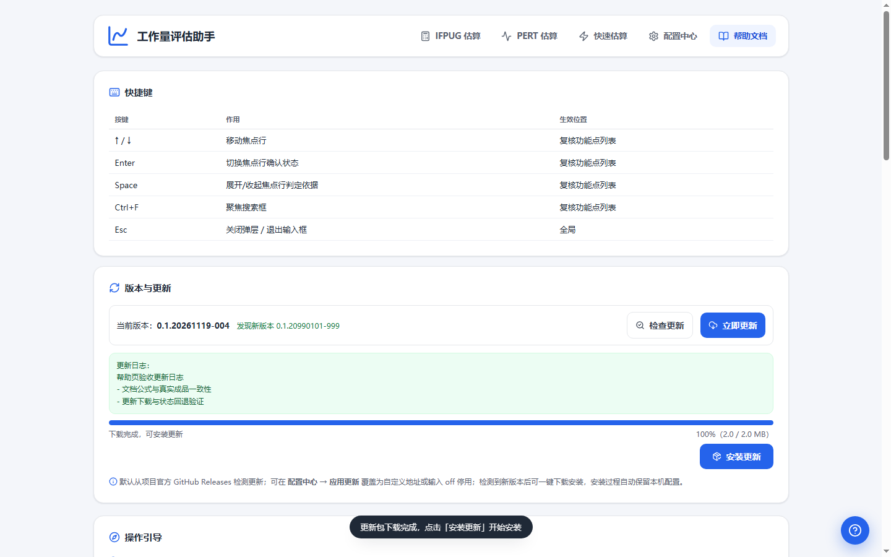
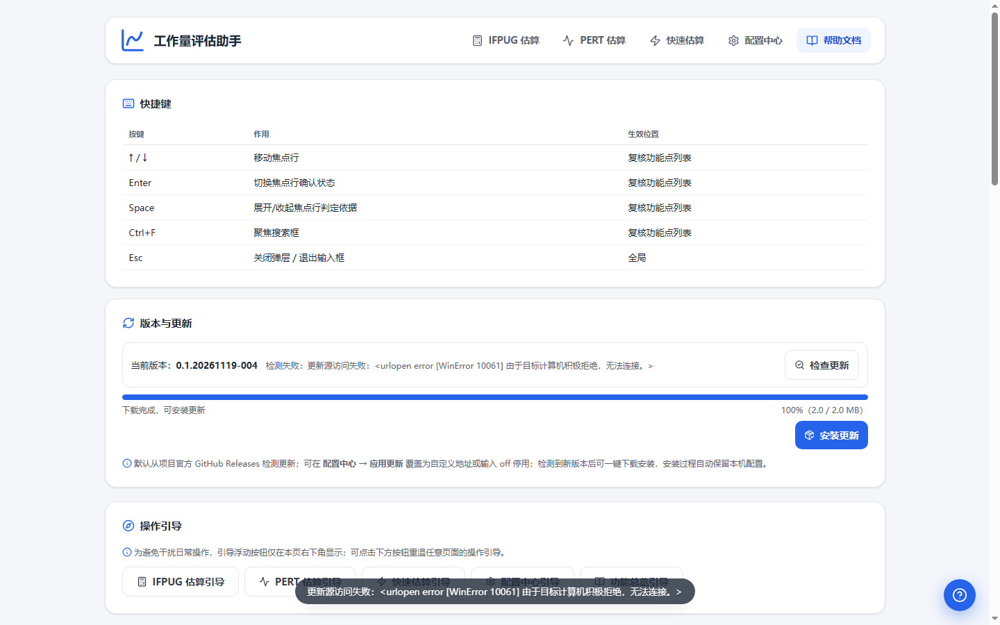
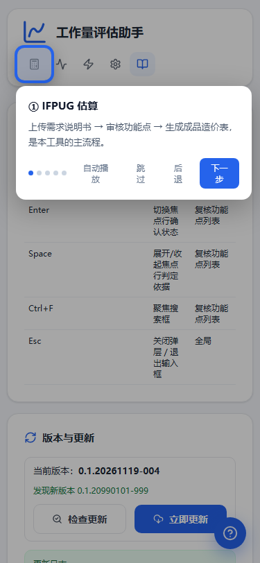
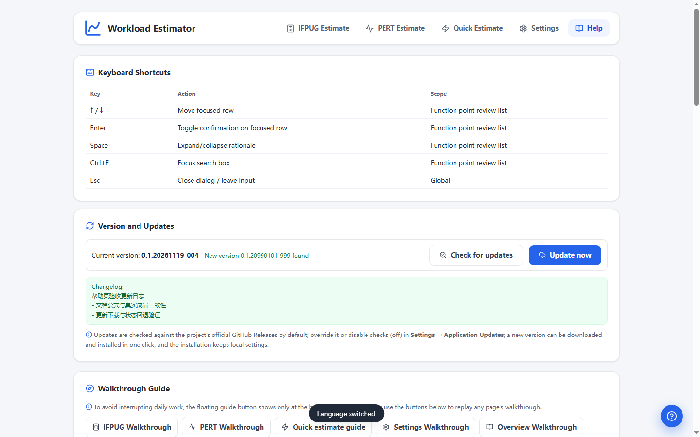

# 帮助文档菜单页 UI 验收与质量报告

- **验收对象**：帮助文档菜单页（`#pg-help`）
- **测试日期**：2026-11-20
- **测试数据**：`E:\test\工作量评估\HUNDSUN票据交易管理平台软件V5.0-铁建财务-票据系统线上审批需求说明文档V1.0.3.docx`
- **测试实例**：`http://127.0.0.1:8036/`（Chrome CDP `9341`，隔离数据目录 `C:\Users\hspcadmin\AppData\Local\Temp\we_help_e2e`）
- **应用版本**：`0.1.20261119-004`
- **结论**：**通过，达到高质量验收标准**。UI 全链路断言 **83/83**，生成物独立质量检查 **41/41**，定向回归 **S12 82/82、S19 13/13（2/2 套件）**，全程 0 未捕获 JS 异常；本轮验收共完成 **7 项产品修复**并全部复测通过。

## 1. 验收结论

帮助页四张主卡、快捷键表、6 个文档模块 / 34 个章节、四档响应式、版本检测与更新、5 个操作引导入口、浮动引导按钮、中英双语与无障碍语义均完成端到端验收。真实需求文档经页面同一套 API 识别、审核、生成，成品表由 `openpyxl` / `zipfile` 独立复核，17 项明细可逐条回溯需求文档原文。

| 验收项 | 结果 |
|---|---|
| UI 全链路断言 | **83/83 PASS** |
| 生成物质量独立检查 | **41/41 PASS** |
| 未捕获 JS 异常 | 0 |
| 阻断级缺陷 | 0 |
| 产品缺陷修复后复测 | PASS |
| 定向回归 | **S12 82/82；S19 13/13** |

## 2. 测试覆盖

### 2.1 页面结构与响应式

- 4 张主卡齐全：快捷键、版本与更新、操作引导、帮助文档。
- 快捷键表 5 行，表头“按键 / 作用 / 生效位置”具备表头语义。
- 帮助文档 6 个模块、34 个 `h4` 章节：IFPUG 6、算法 6、快速 4、PERT 7、配置 6、通用 5。
- 1440px 文档网格双列 **527px × 527px**；1024 / 768 / 375px 单列；四档均无横向溢出。
- 375px 版本区“检查更新 / 立即更新”同一行等宽排布，不越界、不重叠；浮动引导按钮在视口内。
- 375px 引导卡宽 340px、左右留白，操作按钮在卡内，不超出 375px 视口。





### 2.2 帮助内容准确性

逐段校验了页面正文与产品实际算法/母版口径：

- IFPUG 五类功能点权重 `ILF 10 / EIF 7 / EI 4 / EO 5 / EQ 4`，重用系数 `1/3、2/3、1`，修改系数 `1.0、0.8、0.2`。
- 规模变更因子 `1.39 / 1.21 / 1.10 / 1.00`；预估功能点法 `ILF 35 / EIF 15`。
- 快速估算两套公式：`35 × ILF + 15 × EIF` 与 `7 × ILF + 5 × EIF + 4 × EI + 5 × EO + 4 × EQ`。
- PERT：`(O + 4M + P) ÷ 6`、标准差 `σ = (P − O) ÷ 6`、`20.83` 人月、调节系数 `0.06 / 0.06 / 0.05 / 0.06`、开发阶段从 `R8` 起。
- 费用口径：`174` 小时、费用分母 `22`、默认 `2.57 万元/人月`。
- 34 个章节均有正文，无空章节、重复章节、TODO / undefined / NaN / 裸 i18n key。

### 2.3 真实文档联动与成品

使用真实需求文档，经页面同一 API 完成识别与生成：

- 识别 **17 项**，类型 **EI=11 / EQ=6**，UFP=68，US=45.333。
- 生成成品 `帮助页验收-真实文档-工作量评估.xlsx`，最终 **32,504 bytes**，4 张工作表。
- 17 项名称全部可在需求文档正文中回溯，无臆造条目；编号连续、名称唯一。
- 成品公式链完整：`J54=SUM(J6:J53)`、`M54=SUM(M6:M53)`、`E3=SUM(规模估算!$M6:$M22)`、`E27=E19*E26/22`。
- 费用链：规模 45.333 → SCF 1.21 → 调整后规模 54.853 → 调整后工作量 46.823 人天 → 费用中值 **5.4698 万元**，与页面/母版公式一致。
- 无 `#REF!` / `#VALUE!` / `#DIV/0!` / `#NAME?` / NaN / 外部链接 / 宏；功能点名称列无公式注入。

### 2.4 版本检测与更新

覆盖完整状态机：

- 自动检测：发现 `0.1.20990101-999`，显示更新日志；版本号来自 `/api/app-info`。
- 手动检查：给出“发现新版本”toast，状态保持 found。
- 下载失败：HTTP 500 → 显示可读失败原因与“重试”，不显示安装按钮。
- 重试成功：2.0 / 2.0 MB 进度到 100%，显示安装按钮、隐藏重试，落盘大小 2,097,152 bytes。
- 安装确认：弹出“安装更新将关闭应用并自动完成安装（本机配置会保留）”确认框；取消后停留帮助页，不启动安装。
- 已是最新：无新版本时隐藏立即更新与更新日志。
- 不可达源：显示可读失败状态，旧更新日志不残留。
- `off` 源：显示“版本检测已停用”，不再误报“检测失败”。
- 恢复 mock 源并重载后，重新检测到新版本，无裸 `help.upd.*` key。





### 2.5 操作引导

- 浮动按钮 `#guide-fab` 仅帮助页显示，`aria-label` / `title` 为“操作引导”。
- 功能总览 5 步：IFPUG → PERT → 快速估算 → 配置中心 → 帮助文档；支持下一步、后退、自动播放、跳过。
- 帮助页 5 个入口分别跳转 `work / pert / fast / config / help` 并打开对应引导，步数与标题正确。
- PERT 引导逐步展开 4 步，使用“标准差”口径，不再出现“方差”。
- 英文态浮动按钮 `aria-label` 为 `Walkthrough Guide`，引导标题/按钮为英文。



### 2.6 多语言

- 英文态 6 个模块标题：Methodology / Algorithms / Quick Estimate / Three-Point Estimation / Settings and AI Assistance / General Features。
- 快捷键表头：Key / Action / Scope；5 个引导按钮均为英文。
- 英文正文无中文残留、无裸 i18n key、无横向溢出；`html lang` 同步为 `en-US`。
- 英文引导标题与按钮正确；切回中文后 6 个文档模块和主卡结构恢复。
- 帮助页更新区动态状态在语言切换后随 `verPaint()` 重绘。



### 2.7 无障碍

- 标题层级：6 个 `h3` + 34 个 `h4`，所有章节归属文档模块，模块内无重复标题。
- 所有帮助页按钮与浮动按钮均有可访问名称；交互控件均可键盘聚焦。
- 版本区从“检查更新”按 Tab 可正常切换到“立即更新”。
- 关键正文、卡片标题、版本状态、章节标题对比度分别为 **14.68 / 14.68 / 5.02 / 6.70**，均 ≥ 4.5。

## 3. 循环修复记录

| 轮次 | UI 结果 | 发现与处理 |
|---|---:|---|
| 第 1 轮 | 70/72 | PERT 引导仍写“方差”，与引擎 `σ=(P−O)÷6` 不符；英文模块标题断言把徽标与标题拼在一起，属测试断言问题。 |
| 第 2 轮 | 71/72 | 隔离数据目录的旧 i18n 字典仍保留“方差”，刷新测试字典后 PERT 逐步口径通过；同时发现 375px 版本按钮换行错位、重载后偶发 `help.upd.found` 裸 key。 |
| 第 3 轮 | 80/83 | 新增无障碍、下载失败重试断言；全局重复 h4 断言误报（不同模块可同名），恢复更新源用例误用空值（实际应显式恢复 mock 地址），375px 按钮行仍需产品侧收口。 |
| 第 4 轮 | **83/83** | 修复 i18n 早于版本状态渲染的竞态、375px 版本按钮行布局；全部 UI 断言通过。独立质量检查随后达到 **41/41**。 |

### 3.1 产品修复（7 项）

1. **PERT 引导“方差”口径错误**：`frontend/guide.js` 两处兜底文案、`data/i18n/zh-CN.json` 的 `guide.help_pert.d` / `guide.pert_in.d`、`data/i18n/en-US.json` 对应英文统一改为标准差 / standard deviation。
2. **375px 引导卡越界风险**：`.guide-card` 改 `box-sizing:border-box`，宽度 `min(340px, calc(100vw - 24px))`，避免 `placeCard()` 在 375px 下把 left 夹到负值。
3. **浮动引导按钮 aria/title 不随语言切换**：`WLGuide.refresh()` 同步刷新 `#guide-fab` 的 `title` 与 `aria-label`。
4. **更新失败/检查开始残留旧更新日志**：检查开始隐藏“立即更新”和旧日志；失败态清理日志；found 态无新备注时清空并隐藏日志。
5. **`off` 更新源误显示“检测失败”**：后端返回 `disabled:true` 并保留兼容 `msgKey`；前端新增 `renderUpdateDisabled()` 与 `help.upd.disabled`，显示“版本检测已停用”。
6. **重载后版本状态偶发裸 key**：更新检测可能早于 i18n 字典就绪，`verPaint()` 已把 `help.upd.found` 写入 `#verState`；在 `DOMContentLoaded` 字典就绪后补一次 `verPaint()`，避免裸键常驻。
7. **375px 版本按钮换行错位**：版本行增加 `ver-row` / `ver-spacer`；≤767px 隐藏弹性占位，检查/更新按钮各占 50% 同一行，避免“一右一左”跨行。

### 3.2 测试脚本修正（非产品缺陷）

- 版本检查按钮选择器 `#verChkBtn`、版本行容器 `#pg-help .cfg-row` 按真实 DOM 修正。
- 章节数从早期误判的 26 修正为 **34**。
- 下载完成断言同时等待进度 100% 与安装按钮可见，避免把异步 `done` 误判为失败。
- 不可达更新源等待 `#verState` 脱离“检测中”，避免 1.8s 固定等待不足。
- 重载后先等待 `goPage` 可用，再进入帮助页，避免应用回到默认 work 页。
- 英文正文无中文断言修正 `\u4e00-\u9fff` 正则转义；恢复更新源用例改为显式写回 mock URL。
- 重复 `h4` 检查限定在单个文档模块内；避免不同模块的“1. 方法依据”被误报。
- 375px 版本按钮断言改为“在同一行 + 矩形不相交”，不再假定固定左右顺序。

## 4. 生成物质量检查（独立复核）

| 检查对象 | 结果 |
|---|---|
| `帮助页验收-真实文档-工作量评估.xlsx` | **32,504 bytes**；SHA-256 `b3b5a677b183a6dd076001e19338cdd83e3a97ff32322df9d90567d4ec871cde` |
| 工作表 | 项目特征 / 规模估算 / 费用估算 / 模板使用说明&基础参数，共 4 张 |
| 明细 | 17 项；EI=11 / EQ=6；编号 1–17 连续；名称唯一；全部可回溯真实文档 |
| 规模 | UFP=68；US=45.333；逐行 US=UFP×2/3；UFP/US 列由母版公式驱动 |
| 费用 | SCF=1.21；调整后规模 54.853；基准生产率 10.67 人时/FP；调整后工作量 46.823 人天；费用 5.4698 万元 |
| 公式锚点 | `J54`、`M54`、`E3`、`E27` 均存在；费用公式含 `/22`；无错误值 |
| 结构安全 | 无宏、无外部链接关系、无公式注入、数值均为有限值 |
| UI 证据 | `ui_results.json` 83/83，0 异常；11 张截图尺寸正确 |
| 质量脚本 | 41/41 PASS，结果见 `quality_results.json` |

## 5. 仓库回归验证

使用带 `openpyxl` / `python-docx` 的 Python 解释器执行定向回归：

```powershell
$env:PYTHON='F:\Program Files\Python3.14\python.exe'
npm test -- --only=S12,S19
```

- **S12 界面多语言**：82/82 PASS；覆盖帮助页中英文标题/正文/更新状态/引导弹层全页扫描，无中文残留。
- **S19 内置 GitHub 更新源**：13/13 PASS；覆盖内置源、自定义源、缺字段、无 exe、`off` 停用、空值恢复与隔离实例守卫。
- 套件汇总：**2/2 通过**。

回归运行时曾因本机同时驻留多组测试 Chrome/服务进程出现 OpenBLAS 内存分配失败；清理隔离测试进程后按单线程 BLAS 复跑通过。属测试环境资源问题，不是产品缺陷。

## 6. 证据文件

目录：`docs/test-reports/help-20261120/`

| 文件 | 说明 |
|---|---|
| `帮助页验收-真实文档-工作量评估.xlsx` | 真实文档基线成品，32,504 bytes |
| `ui_results.json` | UI 全链路 83 条断言、截图清单、最终状态 |
| `quality_results.json` | 独立质量检查 41 条断言及明细 |
| `screenshots/00~09*.png` | 1440 中文、文档区、下载失败/完成、失败态、1024/768/375、引导、英文、最终态，共 11 张 |
| `harness/help_ui_e2e.mjs` | UI 全链路测试脚本（CDP 驱动、真实文档识别、更新/引导/响应式/无障碍/多语言） |
| `harness/help_quality_check.py` | xlsx / 截图 / UI 结果的独立质量检查脚本 |

归档脚本保留本次运行的原始绝对路径，复现时按实际测试实例与证据目录调整。

## 7. 复现方式

```powershell
# 1) 启动隔离测试实例（8036）与 mock 更新源由脚本内自建 8099
$env:WE_DATA='C:\Users\hspcadmin\AppData\Local\Temp\we_help_e2e'
python scripts/server.py 8036 --serve-frontend

# 2) 运行真实文档 UI 全链路
node .\harness\help_ui_e2e.mjs

# 3) 对成品 xlsx / 截图 / UI 结果做独立质量检查
python .\harness\help_quality_check.py

# 4) 受影响回归
$env:PYTHON='F:\Program Files\Python3.14\python.exe'
npm test -- --only=S12,S19
```

测试实例使用独立 `WE_DATA`，未读写用户正式数据目录；更新包为 2 MB 假 exe，只下载、校验进度与确认框，不执行安装。

## 8. 残余风险与说明

- 更新流程使用本机 mock 源与假安装包，未执行真实 GitHub Releases / NSIS 安装；真实安装器签名、UAC、升级保留配置等需在发布候选包上另行验收。
- xlsx 公式缓存由后台异步补算；本次质量检查读取的是补算完成后的最终文件（25,163 bytes → 32,504 bytes），公式与缓存值均已复核。若在生成返回瞬间读取，可能只能看到未补算版本。
- 既有用户数据目录的 `data/i18n` 字典采用“缺键才补”的增量播种策略；历史上已存在的同名键不会在升级时被覆盖。本轮通过刷新隔离测试目录验证当前内置字典，未改变该升级合并策略。
- 真实文档按当前“章节标题级识别”口径生成，候选描述粒度偏粗（如“审批流程（识别自文档标题）”）；本轮只验证页面内容、联动与成品一致性，未改变识别算法语义。
- 测试数据与证据均在独立目录，未污染仓库数据；报告只读引用，不修改用户正式数据。

**最终判定：帮助文档菜单页达到高质量验收标准，可进入后续集成/回归阶段。**
