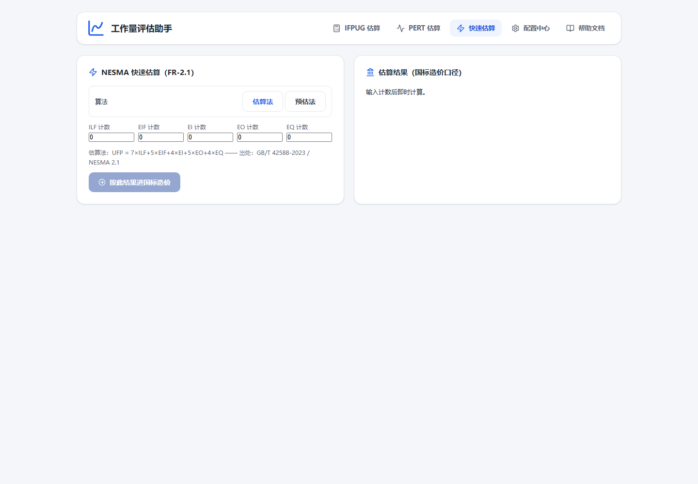
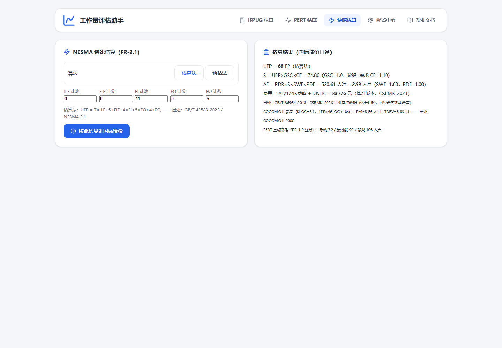
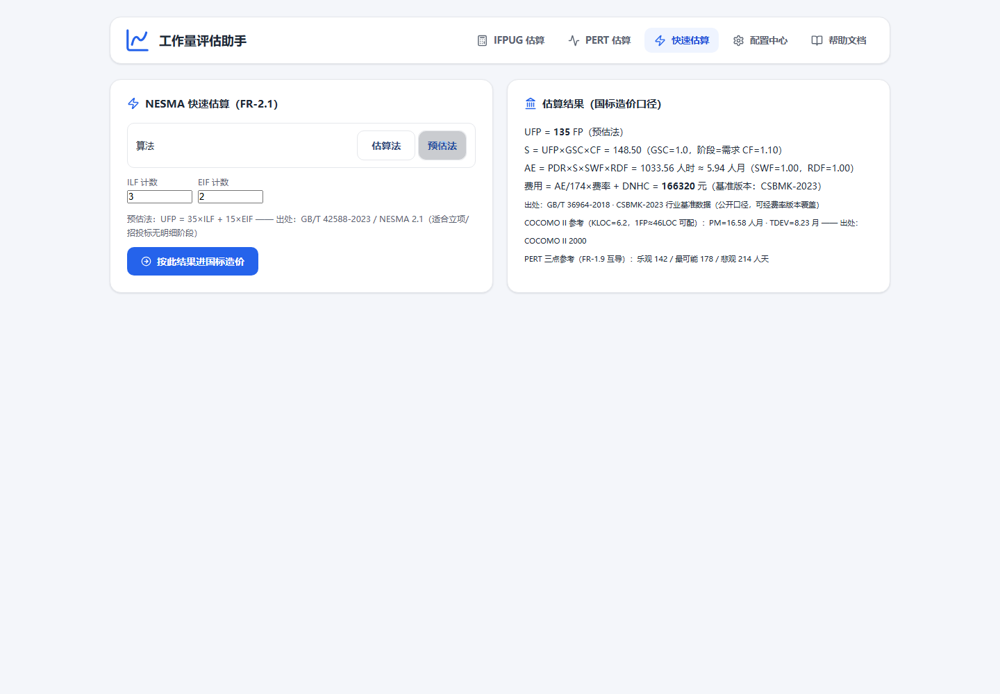
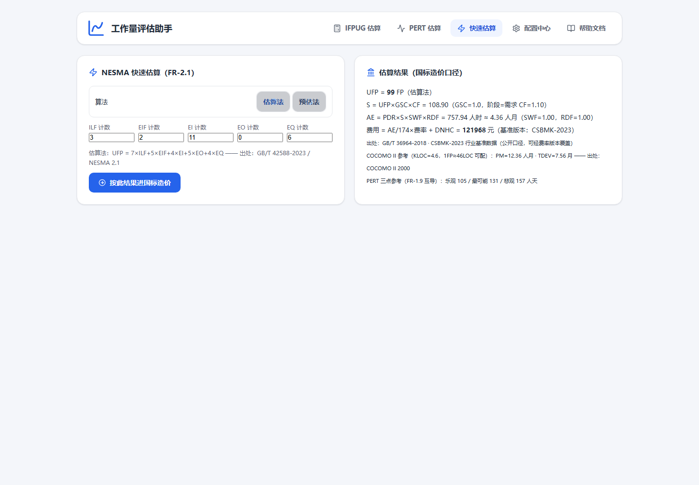
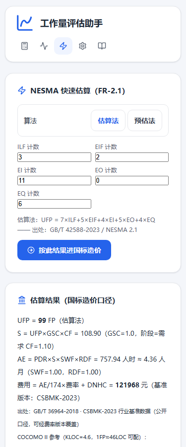
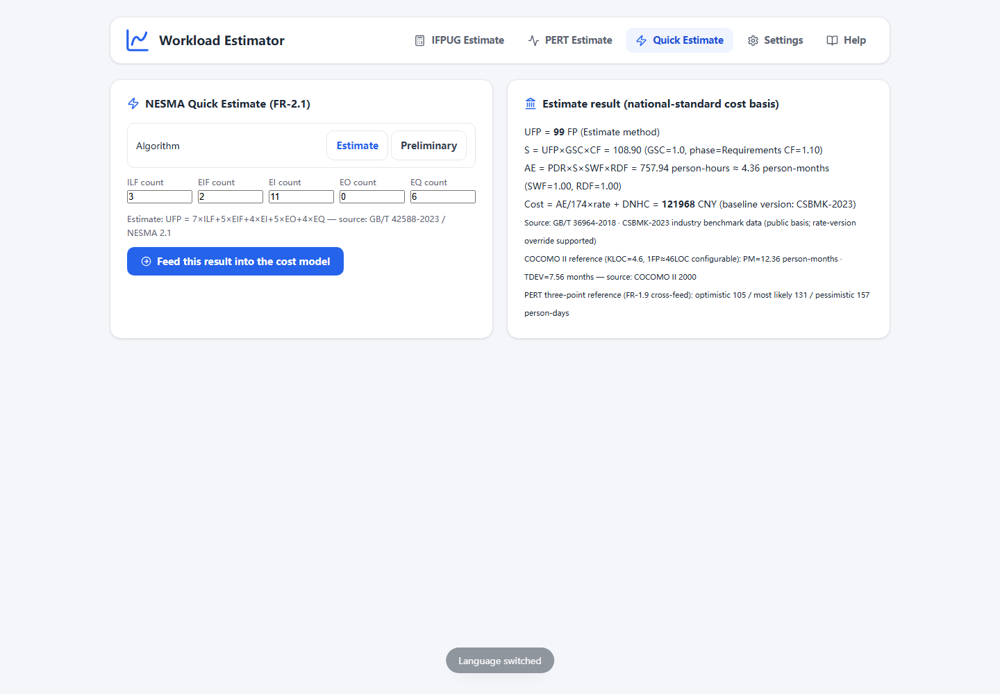

# 快速估算页 UI 验收与质量报告

- 日期：2026-11-19
- 页面：`快速估算`（`#pg-fast`，NESMA 快速估算）
- 测试文档：`E:\test\工作量评估\HUNDSUN票据交易管理平台软件V5.0-铁建财务-票据系统线上审批需求说明文档V1.0.3.docx`
- 服务：`http://127.0.0.1:8033/`（`/health` 就绪，费率版本 CSBMK-2023）
- 结论：**通过**。UI 53/53、独立质量复核 56/56；全仓库回归 19/20，快速页相关套件全绿。S17 产品断言全部通过后在测试夹具 teardown 出现 CDP 超时，详见第 7 节。

## 1. 测试数据与口径

快速估算页没有“上传需求文档”的控件，页面本身只接受 ILF/EIF/EI/EO/EQ 计数。因此用真实文档走同源 `/api/recognize`（`llm_enabled:false`）得到 17 条候选，再按类型汇总成页面计数：

| 类型 | ILF | EIF | EI | EO | EQ | 合计 |
|---|---:|---:|---:|---:|---:|---:|
| 真实文档识别条数 | 0 | 0 | 11 | 0 | 6 | 17 |

估算法：`UFP = 7×0 + 5×0 + 4×11 + 5×0 + 4×6 = 68 FP`。

真实文档没有 ILF/EIF，因此“预估法”的公式验证另取控制值 `ILF=3、EIF=2`（`35×3+15×2=135 FP`）；该组数值只用于验证预估法公式与切换逻辑，不冒充文档识别结果。

## 2. UI 测试矩阵

| 维度 | 覆盖内容 | 结果 |
|---|---|---|
| 初始态 | 页面可见、默认估算法、五项计数、公式、输入提示、按钮禁用、无横向溢出 | 通过 |
| 真实文档计数 | EI=11、EQ=6 → UFP=68、S、AE、费用、COCOMO、PERT | 通过 |
| 预估法 | 仅 ILF/EIF 两项、公式切换、UFP=135、结果方法标识 | 通过 |
| 双算法切换 | 切到预估法再切回，EI/EQ 与 ILF/EIF 全部保留，UFP 从 68/135 回到 99 | 通过 |
| 计数边界 | 空值、负数、小数归一化为非负整数；输入框回写 | 通过 |
| 按钮守卫 | 无计数/清空时禁用；有 UFP 后启用；无 IFPUG 明细时只记录 UFP 并提示 | 通过 |
| 响应式 | 1440、1280、1024、768、375 宽；无横向溢出；375 下计数两列且输入框可用 | 通过 |
| 中英切换 | 公式、计数标签、结果、费率出处全部翻译；切回中文不丢计数 | 通过 |
| 稳定性 | 全程无页面 JS 异常、无 console error | 通过 |

截图：

## 3. 计算结果质量复核

质量脚本不调用页面 JS，直接用 `scripts/gb_engine.py` 独立复算，再与页面结果文本对照：

| 场景 | UFP | S | AE（人时） | 费用（元） | 人月 | COCOMO PM / TDEV | PERT O/M/P（人天） |
|---|---:|---:|---:|---:|---:|---:|---:|
| 估算法（真实文档计数） | 68 | 74.80 | 520.61 | 83,776 | 2.99 | 8.66 / 6.83 | 72 / 90 / 108 |
| 预估法（ILF=3/EIF=2 控制值） | 135 | 148.50 | 1,033.56 | 166,320 | 5.94 | 16.58 / 8.23 | 142 / 178 / 214 |
| 切回估算法（计数保留后） | 99 | 108.90 | 757.94 | 121,968 | 4.36 | 12.36 / 7.56 | 105 / 131 / 157 |

复核断言 56/56 通过，包含：

- UFP/S/AE/费用/PERT/COCOMO 与 `gb_engine` 逐项一致；
- 需求阶段 `CF=1.10`，快速口径 `SWF=1.00、RDF=1.00` 在结果中明示；
- UFP 与费用为整数，S/AE 为两位小数，无 `74.80000000000001` 一类浮点尾数；
- 费率版本 `CSBMK-2023`、出处 `GB/T 36964-2018` 可追溯；
- 真实文档 17 条、EI=11/EQ=6 的计数来源可复核。

## 4. 本轮修复

| 问题 | 修复 |
|---|---|
| i18n 未就绪时进入快速页，计数标签/公式暴露 `ne.count_label`、`ne.formula.est` | `fastRender` 先 `await i18nLoad()`；`DOMContentLoaded` 与语言切换后补一次快速页重绘；动态结果移除静态 `data-i18n`，避免被覆盖 |
| 估算法→预估法→估算法切换后 EI/EO/EQ 被清空 | 新增跨模式 `fastCountsV` 状态，隐藏类型也保留；切回后五项计数完整 |
| 结果出现超长浮点小数 | S/AE/CF 统一两位小数格式化 |
| 公式标注 `SWF×RDF` 但未说明取值 | 结果明确显示 `SWF=1.00，RDF=1.00`（快速估算口径） |
| 无计数时展示一屏 0 结果，且“按此结果进国标造价”可点击 | 无有效 UFP 时保留输入提示；按钮禁用；`fastToGb()` 再加 UFP 守卫 |
| 计数可输入负数/小数 | 非负整数归一化并回写输入框 |
| 375px 下五列计数过窄 | ≤640px 改两列 |
| 768px 导航 tooltip 撑出 19px 横向滚动 | ≤820px 隐藏导航 tooltip |
| 中英切换后快速页公式/标签不重绘 | `reRenderAfterLang()` 增加 fast 分支 |
| 旧安装数据目录的 i18n 同名 key 不会自动升级，因子说明可能仍不显示 | `ne.res_ae` 保持原译文，新增独立 `ne.res_factors` 键并由结果区追加；`_i18n_seed` 会为旧数据目录补齐缺失新键 |
| 英文态费率出处仍残留中文“行业基准数据（公开口径…）” | 新增 `ne.src.csbmk2023` / `ne.src.csbmk2024` 中英译文，按费率版本映射；未知版本回退原始出处，不丢数据 |
| PERT 阶段表头英文 “Expected days” 不符合术语表 | 改为 “Expected person-days” |

## 5. 循环记录

| 轮次 | UI 结果 | 主要失败 | 处理 |
|---|---:|---|---|
| 第 1 轮 | 21/30 | i18n key 暴露、初始全 0 结果、空结果可提交、浮点尾数、SWF/RDF 未明示、切换丢计数、768 溢出 | 完成第一轮修复 |
| 第 2 轮 | 49/51 | 测试数据目录 i18n 字典仍为旧副本；768 导航 tooltip 溢出 | 刷新测试数据字典；隐藏窄屏 tooltip |
| 第 3 轮 | 51/51 | — | 通过 |
| 边界补充 | 53/53 | — | 增加负数/小数归一化验证后仍全绿 |
| 回归加固 | 53/53 | — | 因子说明改为独立 `ne.res_factors` 键，兼容旧安装数据；重建后复测仍全绿 |
| 出处本地化 | 53/53 | — | 费率出处按版本映射中英字典，英文结果不再残留中文；UI 断言加入英文出处检查 |
| 质量复核 | 56/56 | — | 独立 `gb_engine` 复算全部一致 |

## 6. 其他校验

- `scripts/test_guide.py`：通过；
- `tests/i18n_check.py`：16 项全绿（含术语表一致性）；
- `tests/unit_engine.py`（S2）：全部通过；
- 全仓库 `npm test`：见第 7 节。

## 7. 全仓库回归

命令：`$env:PYTHON='F:\Program Files\Python3.14\python.exe'; npm test`

结果：**全量 19/20 套件通过**；S1–S16、S19、S20 全绿。最终代码新增费率出处的两枚翻译后，S12 单独复跑 **82/82**，字典 **918 键**双向对齐，快算页英文态全页扫描无中文残留。

- **S17 Electron 关闭行为实机烟测**：A–E 全部产品断言 PASS（托盘、退出、弹框、bridge、选择持久化均符合预期）；随后测试脚本在 teardown 连接已关闭的 Electron 时抛出 `cdp timeout: Page.enable`（`tests/electron_cdp.mjs:98`）。属测试夹具清理异常，不是快速页改动引入的产品回归。
- **S18 免安装产物冒烟**：5 项包结构断言通过（exe、sidecar、托盘图标、app.asar 依赖齐全）；实机场景因端口 8020 被外部进程占用而整体 SKIP，不作为本页验收依据。
- 完整日志：同目录 `npm-test-summary.md`（原 `logs/test_report_1795092689388.md`）。

## 8. 产物说明

快速估算页是即时计算器，不产生独立 xlsx 文件；它的“生成物”是页面最终计算结果，以及无 IFPUG 明细时记录的 UFP 交接状态。正式可交付的 xlsx 仍由 IFPUG 估算结果页生成，本报告不对快速页伪造下载产物。

本报告及证据位于 `docs/test-reports/quick-20261119/`；原始 UI 结果见 `ui_results.json`，质量断言见 `quality_results.json`，页面快照见同目录 PNG。
