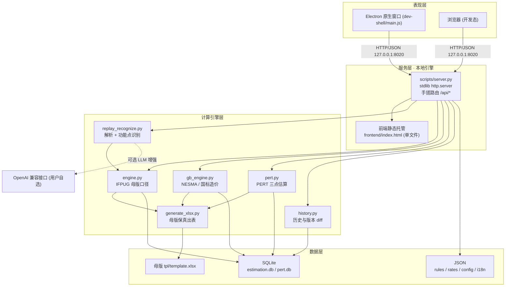
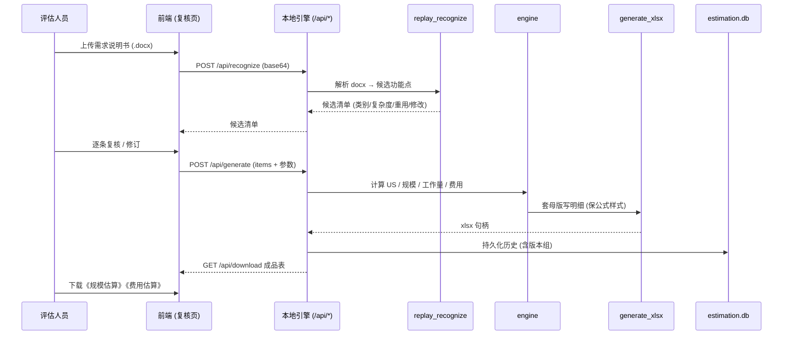
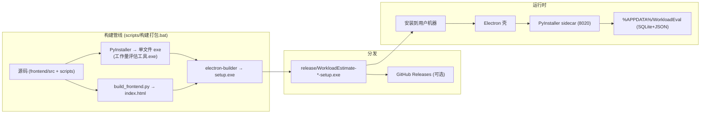

# 系统架构设计文档

> 适用版本：`package.json` `0.1.20261101-001`
> 文档性质：基于工作空间源代码逐模块核实的**现行架构口径**，所有描述均可在 `scripts/`、`frontend/src/`、`dev-shell/`、`tpl/` 中找到对应实现，无虚构组件。
> 关联文档：计算方法论与分项决策见 `docs/概要设计说明.md` 与各 `docs/设计-*.md`；本文件聚焦**结构与交互**，不重复计算口径细节。

---

## 一、引言与系统概述

### 1.1 业务背景

面向造价评估人员的**半自动化**软件项目工作量评估工具。评估人员上传需求说明书（`.docx`），引擎按 IFPUG 功能点法识别候选功能点，人工逐条复核类别 / 复杂度 / 重用 / 修改类型后，一键生成与企业造价母版公式、样式完全一致的成品评估表（`xlsx`）。同时提供 NESMA 快速估算、GB/T 36964 国标造价与 PERT 三点估算，覆盖需求早期到交付后全周期。

### 1.2 核心目标

- **保真出表**：成品表与企业造价母版逐格一致（含公式与样式），Excel 打开即重算，无需人工套表。
- **全本地运行**：需求文档、历史、配置均不出本机；LLM 增强为可选，由使用者自配可访问的 OpenAI 兼容接口。
- **离线可用**：前端图标库本地内联、徽章本地 SVG，无 CDN / 图床依赖，内网环境正常渲染。

### 1.3 范围边界

| 类别 | 范围 |
|---|---|
| 输入 | 需求说明书（docx）、人工录入估算项、配置中心的费率 / 母版 / 规则 |
| 输出 | 成品 xlsx（《规模估算》《费用估算》）、PERT 成品表、用户故事（MD/CSV）、导出摘要 |
| **不做** | 全自动无审核出表、报价审批流转、移动端适配、云端同步、多租户 |

### 1.4 关键术语

| 术语 | 含义 |
|---|---|
| 功能点 | IFPUG 五类：ILF / EIF / EI / EO / EQ |
| UFP | 未调整功能点：企业母版按类别默认权重（复杂度仅作记录）；标准 IFPUG 按 DET/RET/FTR 判复杂度取标准权重 |
| US | 规模明细：`UFP × 重用系数 × 修改系数` |
| 候选清单 | 引擎识别出的待人工确认功能点集合 |

---

## 二、总体架构

### 2.1 分层视图

系统分为四层：**表现层（Electron 原生窗口 / 浏览器）→ 服务层（本地引擎 HTTP API）→ 计算引擎层 → 数据层**。表现层与数据层之间不经过任何公网，全部在 127.0.0.1 本机闭环。



### 2.2 部署形态

| 形态 | 入口 | 说明 |
|---|---|---|
| 开发态 | `npm start` → `dev-shell` + `python scripts/server.py --serve-frontend` | Electron 壳拉起 Python 后端，窗口内托管前端 |
| 桌面态 | `release/WorkloadEstimate-*-setup.exe` | Electron-builder 打包；壳以 sidecar 方式静默启动 PyInstaller 单文件 exe |
| 命令行 | `python scripts/we_cli.py --docx ... --out ...` | 无人值守出表，退出码可信（0 成功 / 2 输入非法 / 3 生成失败） |

### 2.3 技术约束

- 引擎**零框架依赖**：仅用 Python 标准库 `http.server` + `openpyxl` + `python-docx`（`README` 明确）；前端零框架、零 CDN。
- 端口约定：产品端口 **8020**（`dev-shell/main.js` `PORT=8020`）；测试 / CDP 冒烟使用隔离端口（80xx / 93xx），与产品端口互不干扰。

---

## 三、模块详细设计

### 3.1 表现层（前端）

源码位于 `frontend/src/`（`index.src.html` + `js/*` + `css/*`），由 `scripts/build_frontend.py` 按文件名字典序拼接为单文件 `frontend/index.html`（图标库 lucide 已内联）。**改 `src` 后必须重新构建**，否则运行的是旧产物。

| 模块文件 | 职责 |
|---|---|
| `00_vendor_lucide.js` | 内联图标库（离线可用） |
| `01_core.js` | 应用核心：路由、状态、API 客户端 |
| `02_..._进度条_后台真实阶段.js` | 生成分阶段进度轮询（对应 `/api/generate/progress`） |
| `03_..._结果页图表摘要_导出.js` | 结果页图表摘要与导出 |
| `04_..._结果页信息架构_锚点.js` | 结果页信息架构 / 锚点导航 |
| `05_..._ne.js` | 复核表格增强与规则沉淀 |
| `06_..._主题系统.js` | 主题系统：浅色 / 深色 / 高对比 + 品牌色令牌 |
| `07_..._批量.js` | 批量操作 |
| `08_..._估算历史_列表_重开.js` | 估算历史列表与重开复用 |
| `20_m9_eco.js` | 生态扩展入口 |
| `21_component_table.js` | 通用表格组件 |
| `22_..._动效_空态插画.js` | 动效与空态插画 |
| `23_window_behavior.js` | 窗口关闭行为（与壳 IPC 协同） |

样式分三层：`css/10_main.css`（布局）、`css/20_components.css`（组件）、`css/30_motion_empty.css`（动效 / 空态）。界面提供**中 / 英双语**（`data/i18n` 字典，813 组 key 全量对齐）与三套主题；**交付物文案恒为中文**（见 `docs/设计-多语言边界-交付物恒为中文.md`）。

### 3.2 服务层（本地引擎）

`scripts/server.py` 基于 `http.server` 实现，`do_GET` / `do_POST` 内以 `path ==` / `path.startswith` 手搓路由，无第三方 Web 框架。职责：① 托管前端静态资源；② 暴露 `/api/*` REST 接口；③ 提供生成进度轮询与运行任务查询（`/api/jobs/running`）。

主要接口（完整清单见 `README`「主要接口」）：

| 类别 | 路径示例 | 说明 |
|---|---|---|
| 识别 | `POST /api/recognize` | docx(base64) → 候选功能点清单 |
| 生成 | `POST /api/generate`、`GET /api/generate/progress`、`GET /api/download` | 出表与进度 / 下载 |
| 配置 | `GET/POST /api/config`、`/api/config/test`、`/api/config/models` | LLM 预设、连接测试、模型拉取 |
| 上下文 | `GET/POST /api/context` | 项目目录扫描与技术栈分析 |
| 历史 | `GET/POST /api/history`、`/api/history/diff` | 持久化与版本对比 |
| 规则 / 费率 | `GET/POST /api/rules`、`/api/rates` | 识别规则、国标基准多版本 |
| PERT | `POST /api/pert/*` | 项目 / 估算项 / 导入 / 生成 |
| 数据运维 | `/api/data/export`、`/api/data/import`、`/api/diag`、`/api/pickdir`、`/api/update/*` | 全量导出导入、诊断包、目录选择、更新 |
| 探针 | `GET /api/health` | 引擎就绪 + 金标准口径回显 |

### 3.3 计算引擎层

| 模块 | 职责 | 关键依赖 |
|---|---|---|
| `replay_recognize.py` | docx 解析 + 规则表驱动功能点识别；可选 LLM 增强 | `recognition_rules.py`、`collect_*.py`、`probe_doc.py` |
| `recognition_rules.py` | 识别规则表（类型 / 修改类型判定） | — |
| `engine.py` | IFPUG 母版口径：US、调整后规模、工作量、费用；含金标准复算 | `tpl/template.xlsx` 口径 |
| `gb_engine.py` | NESMA 快速估算（预估 / 估算）、GB/T 36964 国标造价 | `data/rates_versions.json`（CSBMK 基线，可配置覆盖） |
| `generate_xlsx.py` | 母版保真生成：写明细、保公式与样式；`--verify` 金标准回归 | `openpyxl`、`tpl/template.xlsx` |
| `pert.py` | PERT 库与成品表（`预期=(O+4M+P)/6`、`σ=(P−O)/6`） | `pert.db` |
| `history.py` | 估算历史持久化、重开复用、版本 diff | `estimation.db` |
| `validators.py` | 输入 / 配置校验（非法数值 400 拒绝） | — |
| `we_cli.py` | 命令行 / 无人值守出表（退出码可信） | 复用上述引擎 |

### 3.4 桌面壳层（dev-shell）

| 文件 | 职责 |
|---|---|
| `main.js` | 自适应窗口、sidecar 启动 / 回收、端口探测、托盘、单实例锁、关闭前运行任务确认 |
| `preload.js` | `contextIsolation` + `nodeIntegration:false` 的 IPC 桥（`weval:window-behavior:get/set`） |
| `window-prefs.js` | 关闭行为偏好（最小化 / 退出，可「记住选择」） |
| `i18n-shell.js` | 壳侧文案（原生对话框 / 托盘菜单，按 `app.getLocale()` 选内置中英表） |

壳的关键行为（已核实于 `main.js`）：
- **Sidecar 定位**：生产态 `resources/we-eval/工作量评估工具.exe` → 开发态 `release/exe/工作量评估工具.exe` → 回退 `python scripts/server.py --serve-frontend`。
- **端口治理**：启动前 `killPort(8020)` 释放残留；`waitPort` 最多等待 30s；退出时 `killTreePid` 回收子进程树 + 异步释放端口（避免关闭延迟）。
- **安全**：`windowsHide` 静默启动后端、`sandbox:true`、`setWindowOpenHandler` 外部链接走系统浏览器。
- **数据目录**：后端 frozen 时落 `%APPDATA%\WorkloadEval`，卸载 / 重装不丢配置（壳侧**禁止**注入 `WE_DATA` 指向安装目录，否则 NSIS 卸载会整目录删除）。

---

## 四、数据流分析

### 4.1 IFPUG 主链路



### 4.2 LLM 增强链路（可选）

配置中心填写 API 地址 / Key 并启用后，引擎对候选做复核补全，并可注入项目上下文目录扫描出的技术栈 / 规模信息。LLM 调用**仅在用户显式启用且配置可达时发生**，需求文档默认不离开本机。

### 4.3 历史与版本 diff

- 每次生成落 `estimation_history`：`items_json`（与 `/api/generate` 请求体同构，重开直接还原复核态）、`version_group`、`version_no`。
- 每项功能带稳定 ID `stable_id`（`F-` + 10 位十六进制），重开/另存/备份恢复后跨版本不变；`item_id_map` 保存 ID 与版本组、类型、`replaces_id` 映射。
- 类型变更时新建 ID 并在新 ID 上记录 `replaces_id`，旧版本与旧 ID 保留；`GET /api/history/ids/validate` 校验映射一致性。
- 旧库首次打开自动补 ID，迁移前备份 `items_json`；`POST /api/history/ids/rollback` 可回滚，`POST /api/history/ids/migrate` 可回滚后重跑。
- 重开（不换标题）沿用版本组、`version_no+1`；另存为（换标题）新建组并重新发号。
- 两次估算可经 `/api/history/diff` 逐项对比（按稳定 ID → replaces_id → desc/system 匹配，新增 / 删除 / 变更高亮）。

---

## 五、数据架构

### 5.1 持久化存储

| 存储 | 内容 | 落盘位置 |
|---|---|---|
| `estimation.db` (SQLite) | IFPUG / 国标估算历史、版本组 | 用户数据目录（`%APPDATA%/WorkloadEval`，frozen 态） |
| `pert.db` (SQLite) | PERT 项目、估算项、导入 | 同上 |
| JSON | 识别规则、费率基准版本、运行配置、i18n 字典 | 同上（`data/i18n` 由引擎从 `_MEIPASS` 播种到 `%APPDATA%`） |

> 注：PyInstaller `datas` 已收 `frontend` / `tpl` / `data/i18n` 及 `data/recognition_rules.json`、`data/rates_versions.json`（2026-11-10 补收，server 启动时从 `_MEIPASS` 播种到用户数据目录，全新安装不再依赖既有副本）。

### 5.2 关键数据模型（estimation_history）

```sql
CREATE TABLE estimation_history (
  id            TEXT PRIMARY KEY,   -- uuid
  created_at    TEXT NOT NULL,      -- ISO8601 本地时间
  updated_at    TEXT NOT NULL,
  title         TEXT NOT NULL,      -- 需求标题（生成 sid 基名）
  source_name   TEXT,               -- 上传文件名（可空）
  method        TEXT NOT NULL,      -- 估算功能点 | 预估功能点 | NESMA…
  params_json   TEXT NOT NULL,      -- 识别参数快照
  items_json    TEXT NOT NULL,      -- 复核确认明细（与 /api/generate 同构）
  summary_json  TEXT,               -- 服务端 summary
  sid           TEXT,               -- 成品文件名（data/generated/<sid>）
  version_group TEXT NOT NULL,      -- 版本组键
  version_no    INTEGER NOT NULL DEFAULT 1,
  schema_ver    INTEGER NOT NULL DEFAULT 1
);
```

- 保留最近 500 条（`WE_HIST_MAX` 可配），写入时惰性清理；历史库不参与任何上传。
- 母版 `tpl/template.xlsx` 为只读基座：`generate_xlsx.py` 仅向其中写入明细、不改动既有公式与样式，保证 Excel 打开即重算。

### 5.3 安全与隐私

- 计算全本地；`/api/data/export` 导出为 zip（含 schema 版本），`/api/data/import` 回灌；`/api/diag` 导出诊断包（日志 + 数据快照）。
- `WE_DATA` 可指定数据目录；**禁止**指向安装目录（避免卸载丢失）。

---

## 六、技术栈说明

| 类别 | 选型 | 版本 / 作用 |
|---|---|---|
| 后端运行时 | Python（标准库 `http.server`） | 零框架引擎；依赖 `openpyxl`、`python-docx` |
| 前端 | 原生 HTML/CSS/JS（无框架） | 单文件 `frontend/index.html`，lucide 图标内联 |
| 桌面壳 | Electron | `^31`（开发态）、`31.7.7`（electron-builder 打包） |
| 打包 | PyInstaller（后端 sidecar） + electron-builder（壳） | 单文件 exe + NSIS 安装包 |
| 成品表 | openpyxl | 母版保真、公式 / 样式保留 |
| 文档解析 | python-docx | docx 章节 / 表格 / 候选线索解析 |
| 可选 AI | OpenAI 兼容接口 | 用户自配（OpenAI / Claude / 通义 / 火山 / 自定义） |
| 测试 | Node `tests/run.mjs` + Python 单测 | S1–S18 套件（单测 / API 冒烟 / UI CDP 冒烟 / 壳与实机 / 产物冒烟），18/18 全绿为交付线（S17/S18 按环境记 SKIP） |
| 发布 | `publish-release.py` + GitHub Releases | 配置驱动（`publish.config.json`），Token 仅取本地 `.env` |

---

## 七、部署与运维架构



### 7.1 构建与发布

- `scripts/构建打包.bat` 全流程：清 `release` → 依赖校验 → 金标准回归 → 源码 zip → sidecar exe → 桌面安装包。
- `scripts/一键发布.bat` 在构建基础上发布到 GitHub Releases；配置零硬编码（`publish.config.json`），Token 仅从本地 `.env` 读取、绝不入库。
- 版本号取 `package.json` 的 `version`（形如 `0.1.YYYYMMDD-NNN`）。

### 7.2 运行时治理（已核实于 `dev-shell/main.js`）

- **单实例锁**：`app.requestSingleInstanceLock()`，重复启动聚焦已有窗口。
- **子进程回收**：`before-quit` / `will-quit` 一次性 `killTreePid(backendPid)` + 异步释放 8020 端口。
- **关闭前确认**：通过 `/api/jobs/running` 检测进行中的生成 / 补算 / 下载 / AI 识别任务，弹确认框防误关；关闭行为（最小化 / 退出）可记忆。
- **日志**：`logs/backend.log`、`logs/shell.log`（轮转，上限 2MB），进程级 `uncaughtException` / `unhandledRejection` 落盘；`/api/diag` 导出诊断包。

### 7.3 质量与一致性保障

- **金标准**：`python scripts/generate_xlsx.py --verify` 复算母版 `US 合计 = 105.07`，发版前回归。
- **重构守护**：`tests/refactor_guard.py` 对 API 响应做归一化快照逐字节对拍。
- **双语对拍**：`tests/i18n_check.py` 校验界面 key 对齐与服务端 `msgKey` 覆盖。
- 无 Docker / Kubernetes 配置：系统为纯桌面应用，部署形态即「安装包 + 本地进程」，无服务端集群或容器编排。

---

## 八、与其他设计文档的关系

| 文档 | 职责 | 与本文件关系 |
|---|---|---|
| `docs/概要设计说明.md` | 定位、总体架构、计算口径、数据模型 | 本文件的结构 / 交互事实来源之一，本文件不重复计算口径 |
| `docs/设计-前端架构与交互.md` | 前端拆分与构建、复核表格、主题令牌、生态扩展（含国标造价前端） | 3.1 节的事实依据 |
| `docs/设计-结果页与导出.md` | 结果页图表 / 导出管线 / 信息架构 | 3.1 节的补充依据 |
| `docs/设计-数据与运维.md` | 历史与版本、校验、日志诊断备份、S1–S18 测试编排、健壮性与数据安全 | 5.3、7.2、7.3 节的补充依据 |
| `docs/设计-多语言边界-交付物恒为中文.md` | 交付物文案语言口径 | 1.2/3.1 节「交付物恒为中文」的权威口径 |

> 历史上本表曾引用 `设计-国标造价引擎.md` / `设计-前端拆分与生态扩展.md` / `设计-核心链路自动化测试.md` / `设计-运维健壮性与数据安全.md` 四份独立文档，现已分别合并进上表前四份现行文档，引用随之收敛（2026-11-10）。

> 本文件为**架构总览**：涉及具体算法、公式、测试编排、主题令牌等细节，请转对应 `docs/设计-*.md` 与 `docs/概要设计说明.md`，避免口径冲突。
